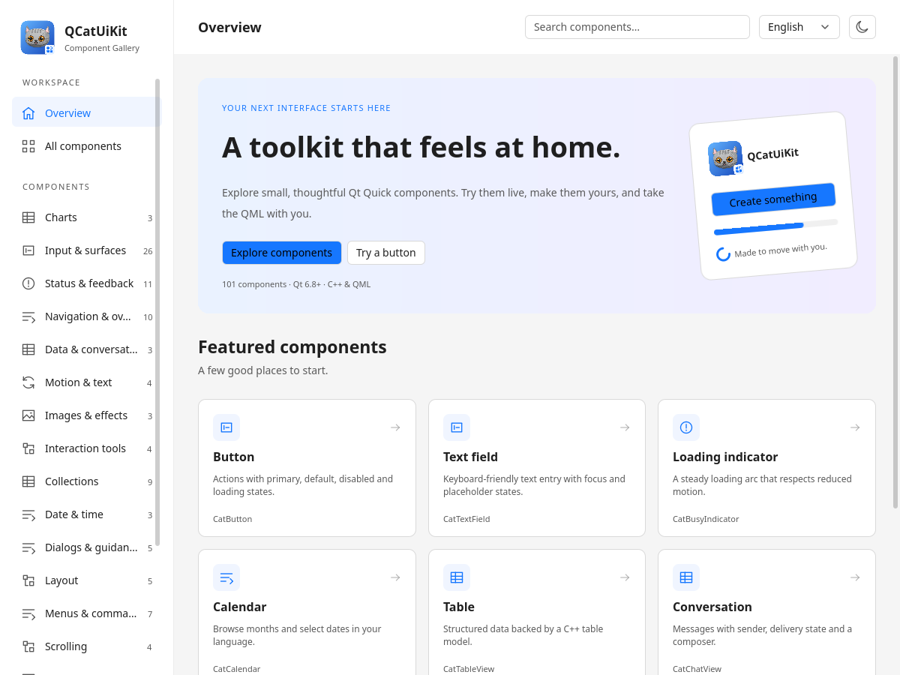
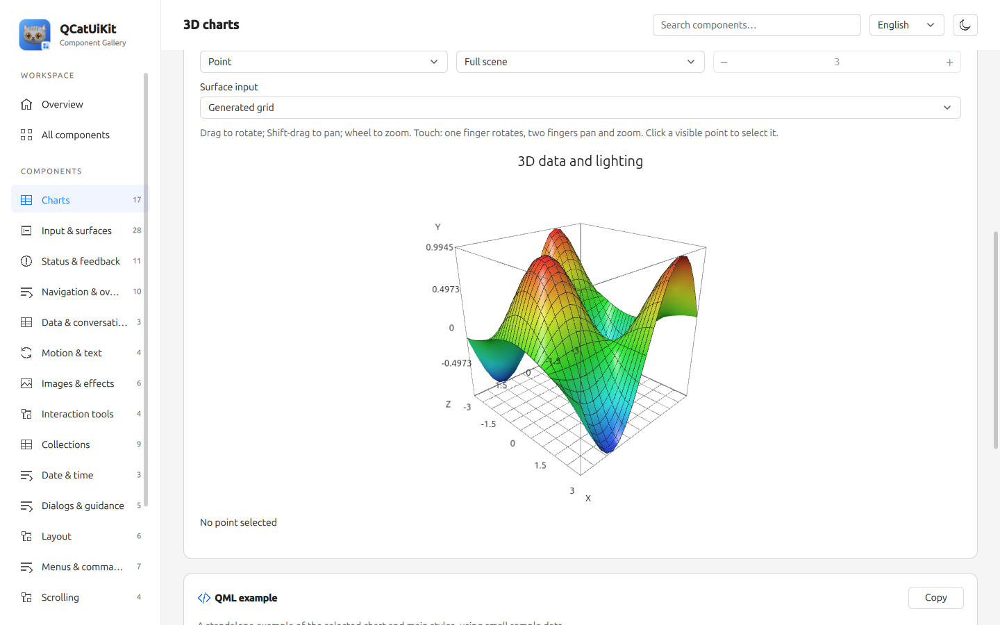
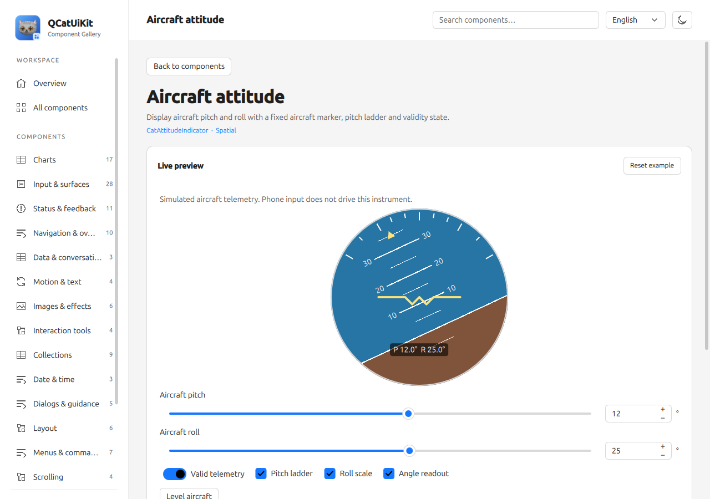
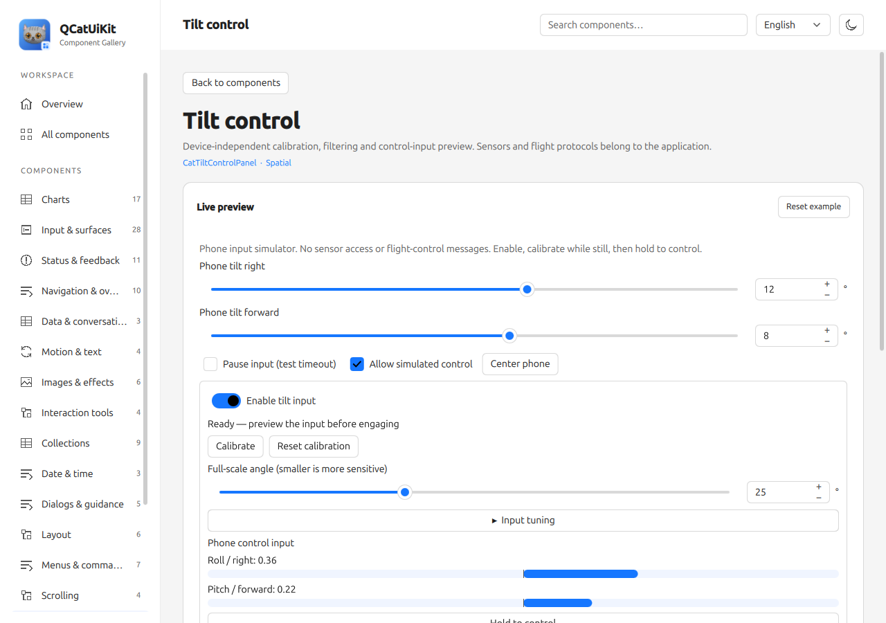
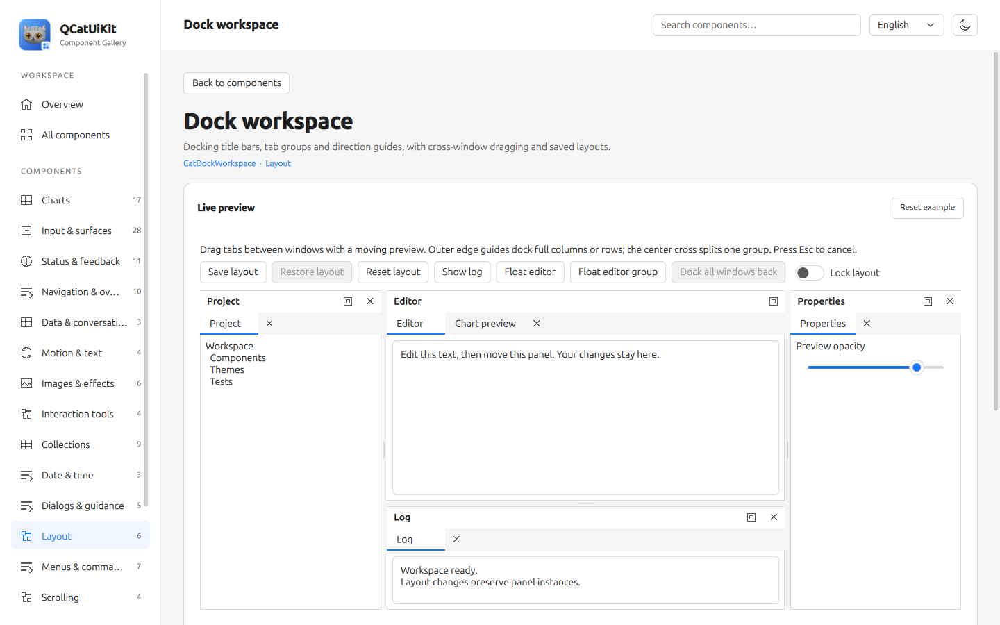
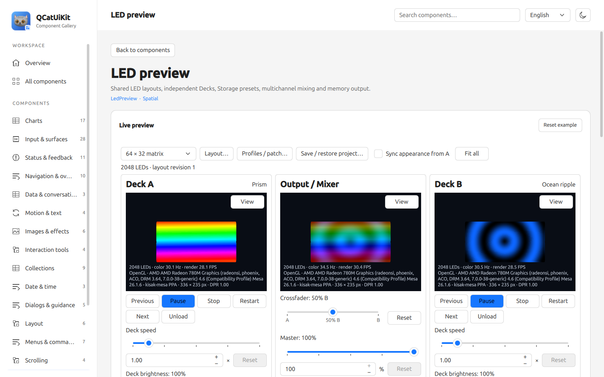
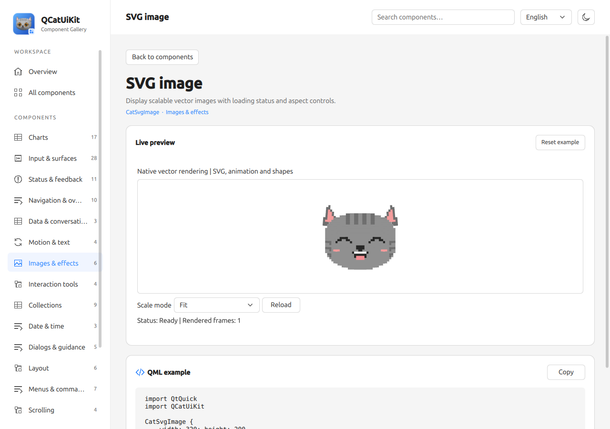
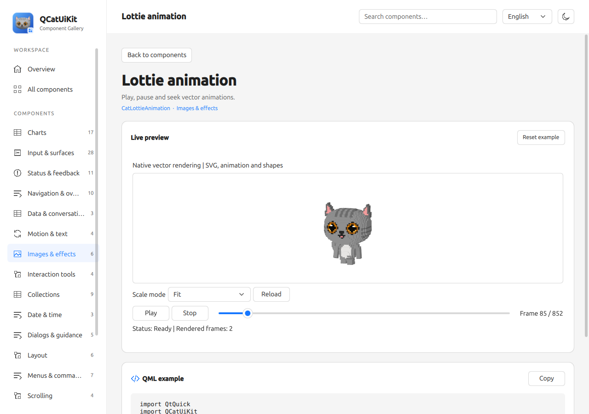
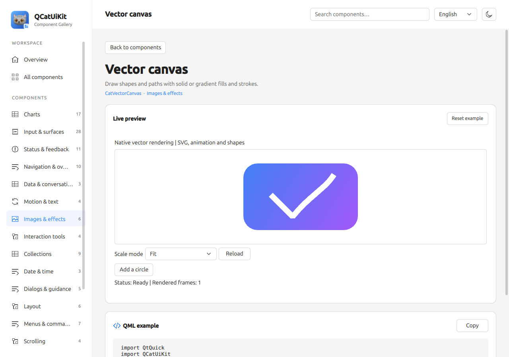

# QCatUiKit

[简体中文](README.md) · [English](README.en.md)


QCatUiKit is a QML component library for Qt 6, with consistent theming, desktop/touch/mobile interaction densities, C++ data models, and native charts. Its Gallery provides interactive examples, copyable QML snippets, and configurable data stress tests.

- **122 Cat-prefixed QML types across 16 Gallery categories**, covering input, navigation, layout, collections, dates, feedback, windows, conversation, and charts.
- **Vector UI (experimental QRhi backend)**: CatSvgImage, CatLottieAnimation and CatVectorCanvas provide SVG display, playback, shapes, paths and gradients, using automatically prepared, pinned ThorVG sources and the bundled experimental QRhi implementation.
- **[LedPreview](src/uikit/doc/LEDPREVIEW.md)**: QRhi instanced 2D/3D LEDs with four point shapes; public Deck/Storage/Mixer components support RGB, RGBW, cold/warm white and memory device output while preserving the RGBA8 API.
- **Theming**: light and dark modes, a brand color, semantic tokens, local palettes, and reduced motion.
- **Native charts**: 10 basic chart types, step and spline curves, gaps, dashes, range areas, preset and textured markers, six bar layouts, multiple axes, gradient/texture fills, budgeted QML delegates, selection, and streaming interactions, using a private QQuickRhiItem data layer with Qt Quick composition and a software fallback.
- **3D charts**: bars, scatter, trajectories and regular surfaces, with camera, lighting, depth picking and slices; see the [3D guide](src/uikit/doc/CHARTS3D.md).
- **Attitude and tilt**: aircraft telemetry display and device-independent quaternion input; see [integration](src/uikit/doc/ATTITUDE.md). The application owns sensor acquisition and flight protocols.
- **Data models**: table, message, and tree models, with Qt Quick views that create visible delegates on demand.
- **Image export**: save the current 2D/3D chart with its title, axes, legend and overlays as PNG, with explicit pixel dimensions and transparency.
- **[Statistical charts](src/uikit/doc/CHARTSTATISTICS.md)**: public linear fits, residual bands, waterfalls, ordinary/percentage stacked areas and histograms with automatic or unequal bins, counts, frequency, and probability density, preserving raw inputs.
- **[Extended charts](src/uikit/doc/CHARTEXTENSIONS.md)**: independent bubble size/color mapping, dense or sparse heatmaps and scrolling grids, radar normalization, contours/bands, OHLC with volume, and box plots with outliers.
- **Dock workspaces**: split and tab panels, dock full-height columns or full-width rows, drag tabs between windows of the same workspace, float panels or tab groups and dock them back, retain content instances, and save/restore versioned layouts. See [Dock documentation](src/uikit/doc/DOCKING.md).
- **Chinese and English Gallery**: runtime language switching, search, responsive layouts, interactive demos, and continuous stress tests.
- **Shared library and CMake package**: exported targets, a QML plugin, public C++ headers, and runtime version queries.

The current default version is **1.0.0-experimental**, with **ABI major version 1**. The release channel is independent of the Debug/Release build configuration.



[Dark touch preview](src/uikit/doc/images/gallery-touch.png) · [Narrow layout](src/uikit/doc/images/gallery-mobile.png) · [Charts preview](src/uikit/doc/images/gallery-charts-desktop.png)

The basic previews above were captured on 2026-10-12. Current feature previews follow below; see [capture scenarios and regeneration](src/uikit/doc/SCREENSHOTS.md).

## Feature previews

These screenshots were captured from the current Gallery on **2026-10-26**. The 3D, LED and vector pages use a native graphics session; the vector QRhi backend remains experimental. Tilt data comes from the simulator, without real sensors or flight-control integration.

| 3D charts | Aircraft attitude |
| --- | --- |
| [](src/uikit/doc/CHARTS3D.md) | [](src/uikit/doc/ATTITUDE.md) |
| [Surfaces, camera, lighting and slices](src/uikit/doc/CHARTS3D.md) | [Aircraft telemetry display, separate from phone input](src/uikit/doc/ATTITUDE.md) |

| Tilt input | Dock workspace |
| --- | --- |
| [](src/uikit/doc/ATTITUDE.md) | [](src/uikit/doc/DOCKING.md) |
| [Simulated quaternions, calibration and control state](src/uikit/doc/ATTITUDE.md) | [Tabs, splits, floating, docking back and saved layouts](src/uikit/doc/DOCKING.md) |

| LedPreview and workflow | Vector UI: SVG |
| --- | --- |
| [](src/uikit/doc/LEDWORKFLOW.md) | [](src/uikit/doc/VECTOR.md) |
| [Independent A/B decks, storage, mixer and memory output](src/uikit/doc/LEDWORKFLOW.md) | [SVG display and scaling with the experimental QRhi backend](src/uikit/doc/VECTOR.md) |

| Vector UI: Lottie | Vector UI: canvas |
| --- | --- |
| [](src/uikit/doc/VECTOR.md) | [](src/uikit/doc/VECTOR.md) |
| [Playback, pause and seeking; a paused frame is shown](src/uikit/doc/VECTOR.md) | [Declarative shapes, paths, fills and gradients](src/uikit/doc/VECTOR.md) |

See [capture scenarios and regeneration](src/uikit/doc/SCREENSHOTS.md) for the environment, captured states and commands. Images do not replace interaction, platform or performance validation.

## Requirements

| Item | Requirement |
| --- | --- |
| Qt | 6.8 or later: Core, Gui, Qml, Quick, QuickControls2, ShaderTools, matching GuiPrivate development headers |
| CMake / C++ | CMake 3.24 or later and a C++17 compiler |
| Dependency setup | Initial configuration needs network access; Meson is prepared automatically; Python is bootstrapped when needed on Windows x64, while other hosts need Python 3.7+ |
| Gallery | Qt LinguistTools; file dialog examples use QtQuick.Dialogs |
| Automated tests | Qt Test and QuickTest |
| Graphics runtime | 2D controls/charts support software rendering; 3D charts, LED previews and vector components require a hardware graphics backend |

Charts are implemented by QCatUiKit and do not require Qt Charts, Qt Graphs, or WebEngine.

## Build and run

Linux, using a single-configuration generator; replace the Qt installation path:

```sh
cmake -S . -B build/release -GNinja \
  -DCMAKE_PREFIX_PATH=/path/to/Qt/6.x/gcc_64 \
  -DCMAKE_BUILD_TYPE=Release
cmake --build build/release --parallel
./build/release/examples/uikit/gallery/qcat-gallery --language en
```

Run the checks:

```sh
ctest --test-dir build/release --output-on-failure
cmake --build build/release --target QCatUiKit_qmllint qcat-gallery_qmllint
```

See [Building and integration](src/uikit/doc/BUILDING.md) for Windows multi-configuration builds, library-only builds, installation, and deployment.

## Use in an application

Build from source:

```cmake
add_subdirectory(path/to/QCatUiKit qcat-uikit)
target_link_libraries(myapp PRIVATE QCatUiKit::QCatUiKit)
```

Use the module installed into the current Qt kit:

```cmake
find_package(Qt6 6.8 REQUIRED COMPONENTS Quick QCatUiKit)
target_link_libraries(myapp PRIVATE Qt6::Quick Qt6::QCatUiKit)
```

The default install layout follows the build's Qt kit. Run `cmake --install <build>` to install into that kit (an explicitly configured prefix is preserved), then use `import QCatUiKit` directly. The standalone `find_package(QCatUiKit)` entry remains available; separate prefixes and source builds still need a runtime module path. Windows Debug and Release can share one installed kit. See [Building and integration](src/uikit/doc/BUILDING.md) for complete steps and deployment examples.

```qml
import QtQuick
import QtQuick.Controls.Basic
import QCatUiKit

ApplicationWindow {
    width: 640
    height: 400
    visible: true
    color: Theme.tokens.background

    Component.onCompleted: Theme.density = ThemePalette.Touch

    CatButton {
        anchors.centerIn: parent
        text: qsTr("Start")
        primary: true
        onClicked: console.log("activated")
    }
}
```

Applications select the density explicitly; sizes use logical pixels. Public C++ headers include paths such as `<QCatUiKit/ThemePalette>`, `<QCatUiKit/TableModel>`, and `<QCatUiKit/ChartItem>`.

## Gallery and stress tests

Each component page has an interactive preview and a QML example. The toolbar switches language and light/dark mode; settings control the brand color, interaction density, and motion.

| Page | Interactive features | Stress-test capacity |
| --- | --- | --- |
| Charts | 30 demo configurations, curved range areas, area baselines/gradients, bar labels and pie leaders, rectangle/pinch zoom, batch additions/deletions, zoom/pan, sampled or aggregated overviews | Million-record preset retains 1,000,000 raw records per chart in total |
| Table | Batch CRUD, row selection, cell editing, positioning, column resizing | 100,000 rows |
| Conversation | Incoming/outgoing messages, long text, delivery status, history browsing | 10,000 messages |
| Message input | Submission, blank validation, long text, draft restoration | 10,000 submitted messages |

Select a preset and start manually. Tests run continuously until stopped, and stop when leaving the page or hiding the window. Charts sample or aggregate their raw records for display; table and conversation views use virtualization. These capacities are Gallery demo settings. Statistics measure data operations, not GPU frame rates or general performance guarantees. See the [Gallery guide](examples/uikit/gallery/README.md).

## Documentation

Use the [documentation index](src/uikit/doc/README.md) to find a guide by task. The detailed guides are currently in Simplified Chinese.

- [Building, installation, and integration](src/uikit/doc/BUILDING.md)
- [Component catalog and public behavior](src/uikit/doc/COMPONENTS.md)
- [Data models and conversation](src/uikit/doc/MODELS.md)
- [Theming and interaction density](src/uikit/doc/THEMING.md)
- [Chart APIs and data conventions](src/uikit/doc/CHARTS.md)
- [3D charts](src/uikit/doc/CHARTS3D.md)
- [Attitude and tilt](src/uikit/doc/ATTITUDE.md)
- [Dock workspaces](src/uikit/doc/DOCKING.md)
- [LedPreview](src/uikit/doc/LEDPREVIEW.md) and [LED workflow](src/uikit/doc/LEDWORKFLOW.md)
- [Vector UI and experimental QRhi backend](src/uikit/doc/VECTOR.md)
- [Architecture](src/uikit/doc/ARCHITECTURE.md), [versioning](src/uikit/doc/VERSIONING.md), and [ABI](src/uikit/doc/ABI.md)
- [Validation and test commands](src/uikit/doc/VALIDATION.md), and [contributing](CONTRIBUTING.md)

## Agent UI skill

The repository includes [qcatuikit-ui](skills/qcatuikit-ui/SKILL.md), which guides agents through public components, themes, models, and charts to build working Qt Quick interfaces. It includes a complete application starter. Tools that read AGENTS.md can discover the repository entry point; you can also ask an agent to read the skill file directly.

See the [Agent UI guide](src/uikit/doc/AGENT_UI.md) for usage and example prompts.

## License

QCatUiKit is licensed under the [Apache License 2.0](LICENSE). See [NOTICE](NOTICE) for attribution and [LICENSES](LICENSES) for additional licenses covering included code.
