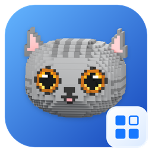
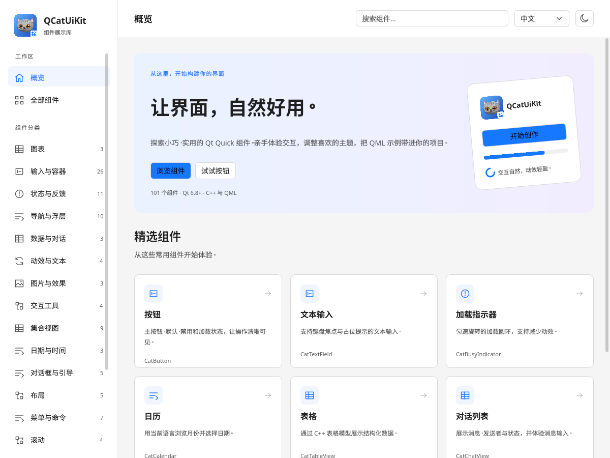

# QCatUiKit

[简体中文](README.md) · [English](README.en.md)



QCatUiKit 是面向 Qt 6 的 QML 组件库，提供统一主题、桌面／触摸／移动交互密度、C++ 数据模型和原生图表。配套 Gallery 可交互体验组件、复制 QML 示例，并运行可配置的数据压力测试。

- **101 个 Cat 前缀 QML 类型、16 个 Gallery 分类**，覆盖输入、导航、布局、集合、日期、反馈、窗口、对话与图表。
- **[LedPreview 灯点预览](src/uikit/doc/LEDPREVIEW.md)**：QRhi 实例化二维/三维灯点、四种点形状；公共 Deck/Storage/Mixer 支持 RGB、RGBW、冷暖双白和设备内存输出，保留旧 RGBA8 API。
- **主题系统**：亮暗模式、品牌色、语义 Token、局部主题和减少动效。
- **原生图表**：10 种图表类型、混合序列、实时数据、缩放、平移和数据提示，使用 Qt Quick SceneGraph。
- **数据模型**：表格、消息和树模型，配合 Qt Quick 视图按需创建可见项。
- **中英文 Gallery**：运行时语言切换、搜索、响应式布局、交互演示与持续压力测试。
- **共享库与安装包**：CMake 导出目标、QML 插件、公开 C++ 头及运行时版本查询。

当前默认版本为 **1.0.0-experimental**，ABI 主版本为 **1**。发布渠道与 Debug／Release 编译配置分别管理。



[暗色触摸预览](src/uikit/doc/images/gallery-touch.png) · [窄屏预览](src/uikit/doc/images/gallery-mobile.png) · [图表预览](src/uikit/doc/images/gallery-charts-desktop.png)

截图来自当前 Gallery；[截图场景与生成方法](src/uikit/doc/SCREENSHOTS.md)。

## 环境要求

| 项目 | 要求 |
| --- | --- |
| Qt | 6.8 或更高，Core、Gui、Qml、Quick、QuickControls2、ShaderTools、匹配版本的 GuiPrivate 开发头 |
| CMake / C++ | CMake 3.24 或更高，C++17 编译器 |
| Gallery | Qt LinguistTools；文件对话框示例使用 QtQuick.Dialogs |
| 自动测试 | Qt Test、QuickTest |
| 图形运行时 | 目标平台的 Qt Quick 后端；软件后端可用于离屏检查 |

图表由本库实现，无需 Qt Charts、Qt Graphs 或 WebEngine。

## 构建与运行

以下为 Linux 单配置构建示例，请替换 Qt 安装路径：

```sh
cmake -S . -B build/release -GNinja \
  -DCMAKE_PREFIX_PATH=/path/to/Qt/6.x/gcc_64 \
  -DCMAKE_BUILD_TYPE=Release
cmake --build build/release --parallel
./build/release/examples/uikit/gallery/qcat-gallery --language zh_CN
```

运行检查：

```sh
ctest --test-dir build/release --output-on-failure
cmake --build build/release --target QCatUiKit_qmllint qcat-gallery_qmllint
```

Windows 多配置构建、最小库构建、安装及部署见 [构建与接入](src/uikit/doc/BUILDING.md)。

## 在应用中使用

源码接入：

```cmake
add_subdirectory(path/to/QCatUiKit)
target_link_libraries(myapp PRIVATE QCatUiKit::QCatUiKit)
```

安装包接入：

```cmake
find_package(QCatUiKit 1 REQUIRED)
target_link_libraries(myapp PRIVATE QCatUiKit::QCatUiKit)
```

应用还需让 QML 引擎找到构建或安装目录中的模块；完整 CMake 与部署示例见 [构建与接入](src/uikit/doc/BUILDING.md)。

```qml
import QtQuick
import QtQuick.Controls.Basic
import QCatUiKit

ApplicationWindow {
    width: 640
    height: 400
    visible: true
    color: Theme.tokens.background

    Component.onCompleted: Theme.density = ThemePalette.Touch

    CatButton {
        anchors.centerIn: parent
        text: qsTr("开始")
        primary: true
        onClicked: console.log("activated")
    }
}
```

密度由应用显式选择，尺寸使用逻辑像素。C++ 公开头可使用 `<QCatUiKit/ThemePalette>`、`<QCatUiKit/TableModel>`、`<QCatUiKit/ChartItem>` 等路径。

## Gallery 与压力测试

Gallery 的每个组件页面包含交互预览和 QML 示例。顶部切换语言及亮暗模式，设置页调整主题色、交互密度和动效。

| 页面 | 可体验内容 | 压力测试容量 |
| --- | --- | --- |
| 图表 | 15 个演示配置、批量增删、缩放平移、采样／聚合概览 | 百万预设保留每图合计 1,000,000 条原始数据 |
| 表格 | 批量增删改、选行、单元格编辑、定位、列宽调整 | 100,000 行 |
| 对话 | 双向消息、长文本、发送状态、历史浏览 | 10,000 条 |
| 消息输入 | 提交、空白校验、长文本、草稿恢复 | 10,000 条提交历史 |

选择预设后手动启动，持续运行并可随时停止；离开页面或隐藏窗口时停止。图表以采样或聚合显示大量原始数据，表格与对话使用视图虚拟化。容量是 Gallery 的演示配置，统计反映数据操作耗时，不是 GPU 帧率或通用性能承诺。详情见 [Gallery 使用指南](examples/uikit/gallery/README.md)。

## 文档

从 [文档索引](src/uikit/doc/README.md) 按任务查找说明：

- [构建、安装与应用接入](src/uikit/doc/BUILDING.md)
- [组件目录与公开行为](src/uikit/doc/COMPONENTS.md)
- [数据模型与对话](src/uikit/doc/MODELS.md)
- [主题与交互密度](src/uikit/doc/THEMING.md)
- [图表接口与数据约定](src/uikit/doc/CHARTS.md)
- [架构](src/uikit/doc/ARCHITECTURE.md)、[版本](src/uikit/doc/VERSIONING.md)、[ABI](src/uikit/doc/ABI.md)
- [验证范围与运行方法](src/uikit/doc/VALIDATION.md)、[贡献指南](CONTRIBUTING.md)

## Agent UI 技能

仓库内置 [qcatuikit-ui](skills/qcatuikit-ui/SKILL.md)，帮助 agent 按公开组件、主题、模型和图表规范编写可运行的 Qt Quick 界面，并附带完整应用模板。支持 AGENTS.md 的工具可通过仓库入口发现它；也可以明确让 agent 读取技能文件。

使用方法与示例提示见 [Agent UI 指南](src/uikit/doc/AGENT_UI.md)。

## 许可证

项目采用 [Apache License 2.0](LICENSE)。相关版权归属见 [NOTICE](NOTICE)，所包含代码的其他许可证保存在 [LICENSES](LICENSES)。
