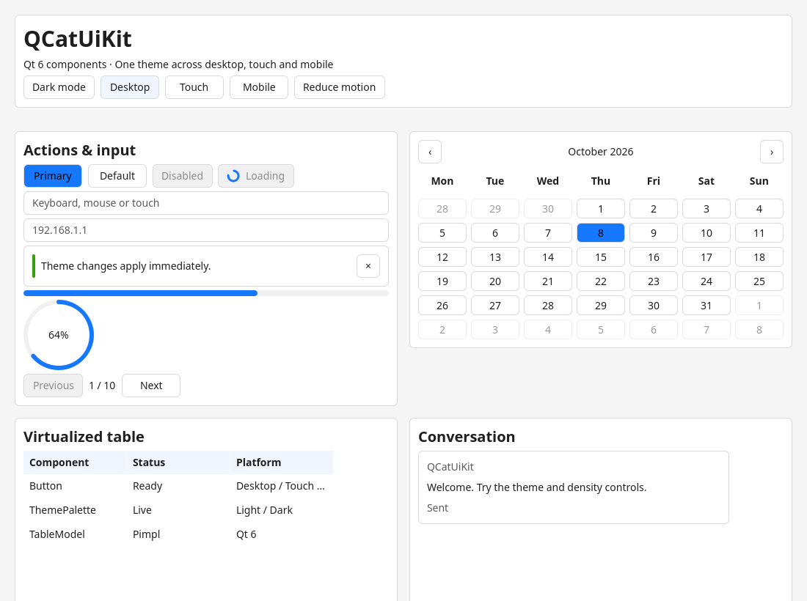

# QCatUiKit

面向 Qt 6 的 QML 组件库。由 QCatGrayQuick 的能力重新设计，提供统一主题、桌面／嵌入式触摸／移动密度，以及采用 Pimpl 的 C++ 共享库。

- Qt **6.8+**、CMake **3.24+**、C++ **17**；只支持 Qt 6。
- 使用 `qt_add_qml_module` 生成 QML 注册、插件、类型信息和资源；`import QCatUiKit`。
- `ThemePalette`、`ChatModel`、`TableModel` 的公开对象只包含私有实现指针；共享库 `SOVERSION 1`。
- 27 个公开 QML 组件，统一颜色、尺寸、焦点、交互状态与减少动效设置。
- 不包含 QCatGrayQuickQrenCodeQml、lottie、Qt5Compat 或第三方图形特效库。
- Apache License 2.0；旧项目的 MIT 归属说明保存在 `licenses/`。



[暗色触摸布局](docs/images/gallery-touch.png) · [移动宽度布局](docs/images/gallery-mobile.png)

## 构建与运行

```sh
cmake -S . -B build -GNinja \
  -DCMAKE_PREFIX_PATH=/path/to/Qt/6.x/gcc_64 \
  -DCMAKE_BUILD_TYPE=Release
cmake --build build
ctest --test-dir build --output-on-failure
cmake --build build --target QCatUiKit_qmllint qcat-gallery_qmllint
./build/examples/gallery/qcat-gallery
```

Windows 多配置构建的可执行文件位于 `build/bin/<config>/`。

需要 Qt Core、Gui、Qml、Quick、QuickControls2；测试还需要 Test、QuickTest。最小部署可传入 `-DBUILD_TESTING=OFF -DQCATUIKIT_BUILD_EXAMPLES=OFF`。交叉编译使用目标平台 Qt 的 CMake toolchain；不要把桌面 Qt 的动态库复制到其他架构。

## 使用

```cmake
add_subdirectory(QCatUiKit)
target_link_libraries(myapp PRIVATE QCatUiKit::QCatUiKit)
```

```qml
import QtQuick
import QtQuick.Controls.Basic
import QCatUiKit

ApplicationWindow {
    width: 600; height: 400; visible: true
    color: Theme.tokens.background
    Component.onCompleted: Theme.density = ThemePalette.Touch

    CatButton {
        anchors.centerIn: parent
        text: qsTr("开始")
        primary: true
        onClicked: console.log("activated")
    }
}
```

组件不会自动根据操作系统猜测交互密度。桌面触摸屏应显式选择 `Touch`；移动窗口可选择 `Mobile`。布局使用逻辑像素，缩放交给 Qt 高 DPI 系统。

## 版本查询

默认构建为实验版 `1.0.0-experimental`；正式构建传入 `-DQCATUIKIT_RELEASE_CHANNEL=stable`。

```cpp
#include <QCatUiKit/Version.h>
auto version = QCatUiKit::versionString();
bool experimental = QCatUiKit::isExperimentalRelease();
```

QML 使用 `LibraryInfo.version`、`LibraryInfo.releaseChannel`、`LibraryInfo.isStable` 和 `LibraryInfo.isExperimental`。查询返回实际加载的共享库信息；发布状态与 Debug/Release 编译模式独立。详见 [版本管理](docs/VERSIONING.md)。

## 安装与复用

```sh
cmake --install build --prefix "$PWD/stage"
cmake -S tests/consumer -B build-consumer \
  -DCMAKE_PREFIX_PATH="$PWD/stage;/path/to/Qt/6.x/gcc_64"
cmake --build build-consumer
./build-consumer/consumer
```

安装后应用使用 `find_package(QCatUiKit 1 REQUIRED)` 与 `QCatUiKit::QCatUiKit`。纯 QML 宿主需要把 `<prefix>/<libdir>/qml` 加到 QML 导入路径。Linux 的模块插件包含指向安装目录中共享库的相对 RPATH；Windows 部署时还需让 `<prefix>/bin` 位于 DLL 搜索路径。应用打包仍应使用目标平台的 Qt 部署工具处理 Qt 插件与运行时依赖。

## 文档

- [组件与公开行为](docs/COMPONENTS.md)
- [主题架构](docs/THEMING.md)
- [迁移对照与行为变化](docs/MIGRATION.md)
- [版本号与正式／实验发布状态](docs/VERSIONING.md)
- [ABI 边界及替换验证](docs/ABI.md)
- [实现架构与维护约定](docs/ARCHITECTURE.md)
- [本地验证记录](docs/VALIDATION.md)

参考文章 [AI 与开源贡献](https://ant.design/docs/blog/ai-open-source-contribution-cn) 主要用于公开契约、回归测试及审查方法；主题分层参考 [Ant Design 定制主题](https://ant.design/docs/react/customize-theme-cn/)。本库采用 Qt 的对象、焦点、模型和声明式绑定机制实现这些原则。
