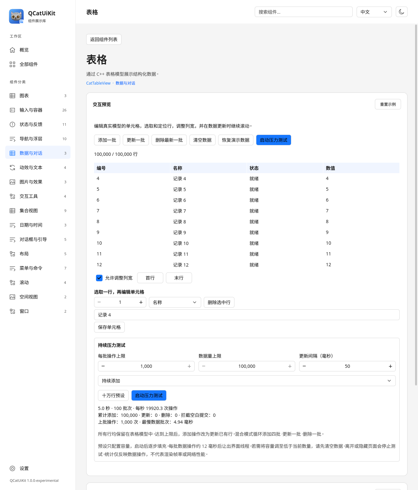

# QCatUiKit Gallery

[项目首页](../../../README.md) · [文档索引](../../../src/uikit/doc/README.md)

Gallery 是组件体验和本地数据测试应用，按 16 个分类组织组件与示例。页面数量不是公开 QML 类型数量：同一组件可有多个用途不同的示例。每个页面包含可操作的预览、重置入口与可复制的 QML 示例。顶部提供搜索、语言和亮暗切换；设置页配置品牌色、桌面／触摸／移动密度和减少动效。

语言默认跟随系统：中文系统使用简体中文，其余使用英文。手动选择在本次运行中生效。切换语言保留当前页面、用户输入、消息、草稿和日期选择。窄窗口使用侧边抽屉导航。

桌宠窗口由 Gallery 持有：关闭桌宠仅隐藏该实例；最小化 Gallery 时桌宠保持独立显示，关闭 Gallery 主窗口则退出应用并释放所有桌宠实例。

## 构建与运行

Gallery 默认随项目构建，需要 Qt LinguistTools。完整步骤见 [构建与接入](../../../src/uikit/doc/BUILDING.md)。

```sh
cmake --build build/release --target qcat-gallery
./build/release/examples/uikit/gallery/qcat-gallery --language zh_CN
./build/release/examples/uikit/gallery/qcat-gallery --language en --page calendar
./build/release/examples/uikit/gallery/qcat-gallery --dark --density touch --page settings
```

Windows 单配置程序位于 `<build>/bin/qcat-gallery.exe`，多配置程序位于 `<build>/bin/<config>/qcat-gallery.exe`。

| 参数 | 含义 |
| --- | --- |
| `--language en\|zh_CN` | 界面语言；省略时跟随系统 |
| `--dark` | 暗色主题 |
| `--density desktop\|touch\|mobile` | 交互密度，默认 desktop |
| `--width <pixels>` | 初始宽度，默认 1200，最小 360 |
| `--page <id>` | home、all、settings 或组件 ID |
| `--chart-demo <0–29>` | 图表演示编号，自动打开对应图表页面 |
| `--led-count <0–100000>` / `--led-layout matrix\|sphere` | LED 页面每路数量及布局，须配合 `--page led-preview` |
| `--led-interval <4–1000>` | 独立 Deck 效果调度间隔，单位 ms |
| `--led-benchmark <seconds>` / `--led-report <path>` | 2 秒暖机后测量 LED 渲染/提交频率，可保存 JSON 并退出 |
| `--smoke-test` | 加载后自动退出 |
| `--screenshot <path>` | 保存窗口截图后退出 |

组件 ID 见 [GalleryCatalog.qml](GalleryCatalog.qml)，例如 `button`、`calendar`、`table`、`chat`、`chatinput`。图表入口见 [GalleryChartCatalog.qml](GalleryChartCatalog.qml)。旧地址 `chart`、`chart-axis`、`chart-series` 分别跳转到折线、坐标轴和面积图。可用 `--width 420 --density mobile` 检查窄屏。截图参数只保存窗口当前可见区域。

## LED 工作流

LED 页面默认使用 64×32 共享布局；A/B 独立播放、Storage/Place 管理、中央混合和内存通道监视器均可操作。布局、预览、灯具映射和项目保存进入独立面板。

接口及预设/多通道流程见 [LED 工作流](../../../src/uikit/doc/LEDWORKFLOW.md)，GPU 与压测见 [LED 预览](../../../src/uikit/doc/LEDPREVIEW.md)。

## 图表体验

图表目录按「二维图表」「三维图表」「扩展图表」「坐标轴与组合」分组，页面仅切换所属类型的变体。CatChart 是绘图容器，CatChartAxis 定义坐标和刻度，CatChartSeries / CatChartSeries3D 提供数据与样式；它们仍是配套的公开 API，不再作为三个重复演示入口。

| 页面 ID | 内容／演示编号 |
| --- | --- |
| `chart-ohlc` | OHLC／K 线与成交量 24 |
| `chart-box` | 箱线／离群点 25 |
| `chart-contour` | 等值线／填色区域 27 |
| `chart-line` | 折线 0、断点曲线 16 |
| `chart-area` | 面积 1、区间面积 15 |
| `chart-bars` | 分组 2、堆叠 3、正负值 13，均支持横向与百分比布局 |
| `chart-scatter` | 散点 4、气泡 5、气泡映射 28 |
| `chart-pie` | 饼图 6、环形 7、多环变体 17 |
| `chart-radar` | 雷达 8、独立维度范围与样式 29 |
| `chart-heatmap` | 热力图 9、格网与滚动更新 26 |
| `chart-3d` | 三维散点、柱状、轨迹和曲面 19 |
| `chart-combination` | 柱状与折线 10、散点与趋势线 14 |
| `chart-fit` | 公共线性拟合与残差带 22，原始观测和拟合统计量 |
| `chart-waterfall` | 瀑布图 23，增减量、小计重置、总计与连接线 |
| `chart-stack` | 普通／百分比堆叠面积 20，正负值、共享断点及显隐 |
| `chart-histogram` | 直方图 21，自动／不等宽分箱及频数／频率／概率密度 |
| `chart-axes` | 多坐标轴 18、时间轴 11、对数轴 12 |

底部 QML 示例及复制内容跟随当前图表和主要样式更新。示例使用少量独立数据，不依赖 Gallery 模块，也不是完整导出预览参数或压力测试数据。重置示例保留所选演示类型，恢复其默认参数；切换页面停止原页面的压力测试。原有编号保持兼容：

| 编号 | 配置 | 编号 | 配置 | 编号 | 配置 |
| --- | --- | --- | --- | --- | --- |
| 0 | 折线 | 5 | 气泡 | 10 | 柱状与折线 |
| 1 | 面积 | 6 | 饼图 | 11 | 时间轴 |
| 2 | 分组柱状 | 7 | 环形 | 12 | 对数轴 |
| 3 | 堆叠柱状 | 8 | 雷达 | 13 | 正负堆叠 |
| 4 | 散点 | 9 | 热力图 | 14 | 散点与趋势线 |

```sh
./build/release/examples/uikit/gallery/qcat-gallery --page chart --chart-demo 7
```

支持批量添加、删除最新数据、清空及恢复；滚轮缩放、拖动平移、双击／Home 重置，图例可控制显示。径向图不使用笛卡尔缩放和平移。

曲线演示可设置阶梯／样条、点标记及虚线长度／间隙／偏移，柱图可切换六种布局。默认双系列各 100,000 点的阶梯／样条使用 CatChart 的分段层次采样，拖动复用曲线索引，放大自动恢复细节，原始数据数量不变。区间面积与断点曲线演示每批增删 6 条、最多 512 条，提供边界交叉、断点、虚线和填充不透明度控件；不显示百万预设或持续压力测试。选择这两项会停止原演示的压力测试。

**百万数据体验**：点击“百万数据预设”，再启动压力测试。预设按整张图合计 1,000,000 条原始记录设置容量、每批 50,000 条总记录及 200 ms 间隔，逐步填充；趋势演示另有 2 个拟合端点。连续测试循环添加四批、删除一批，达到容量后覆盖最旧记录。

Gallery 完整保存源数据，同时采用峰谷采样、等距抽样或分组聚合生成概览。界面分别显示原始量、预览量及处理方式；概览不会随缩放重新细分。预览限制和每类数据语义见 [图表指南](../../../src/uikit/doc/CHARTS.md)。

“重置视图”恢复自动坐标范围，“恢复演示数据”恢复初始数据和参数。切换语言保留源数据与手动范围，切换演示则重新生成对应数据。

折线（0）与断点曲线（16）在图表下方使用公开的 CatRangeSlider 提供 X／Y 两组双滑块，分别调整可见范围的最小值与最大值，也可拖动选中轨道整体平移。只调整一个轴时，另一个轴的自动／手动状态不变；图内平移、缩放及反向轴会同步到滑块。自动视图跟随新数据；手动视图保留当前范围，超出原可选范围的平移会扩展滑块范围。“恢复全图”重新匹配数据，空数据或全部系列隐藏时禁用。底部 QML 示例包含使用 CatRangeSlider 的独立绑定代码；坐标轴适配器属于示例实现。

输入分类提供三个独立演示：CatSlider 展示连续、步进、居中填充和垂直变体；CatRangeSlider 展示自由区间、限制跨度与固定跨度；CatSliderField 展示精确数值输入、单位及默认值恢复。刻度与数值提示可切换，底部 QML 示例随变体更新。公开属性与信号见[滑块文档](../../../src/uikit/doc/SLIDERS.md)。

这些能力也用于其他组件页面：进度条／圆形进度使用刻度、百分比提示及默认值恢复；图表的张力、标记尺寸、面积基线／透明度、柱宽／间距、径向角度／半径和三维光照使用 CatSliderField；LED Deck 的速度、亮度与效果参数以及混合器总亮度支持精确输入，交叉混合使用居中填充和 A／B 刻度。颜色选择器通道提供 RGB 0–255／透明度百分比提示。百分比字段将显示值映射回原来的 0–1 模型范围，窄屏输入自动换行。

图表 X／Y 区间可分别锁定当前跨度；锁定后手柄调整和整段拖动均保持区间大小，外部图表缩放仍会同步新的可见跨度。柱宽、间距、面积透明度／基线和折线标记参数也会更新底部可复制代码。

X／Y 区间在宽屏中等宽排列，范围读数保持单行并在空间不足时省略，端点提示仍显示完整值；平移时数字长度变化不会改变滑块宽度或推移布局。密集折线标记使用锚定原始数据的概览分组，避免平移时反复更换内部标记点。

编号 17 可切换饼图、单环和两／三层同心环，调整起始／扫过角度、半径、内孔、环间距与扇区分离；默认展示外置名称／百分比与彩色引线，可切换内部标签，支持边框和标签开关、增删扇区、清空／恢复及逐环图例隐藏。可用 `qcat-gallery --page chart --chart-demo 17 --language zh_CN` 直接打开，窄屏使用 `--width 420 --density mobile`。

分组、堆叠和正负值柱图提供宽度、间距、边框颜色／宽度，以及标签开关、四种位置、内容、有效数字和边距控件。百分比布局可选择原值加占比；切换回普通布局自动恢复原值模板。语言切换和增删数据保留外观，“恢复演示”恢复默认值。

### 更多图表设置

面积演示（1）支持零值／自定义／绘图区底部基线；面积与区间面积（15）均提供纯色／双色渐变、配色、独立边界颜色、透明末端和填充不透明度。恢复示例重置外观，增删数据及切换语言保留当前外观。渐变以整个绘图区为基准。

区间面积演示支持直线、三种阶梯和三种样条；上下边界共用曲线样式，Catmull-Rom 张力可调整。边界交叉、断点、渐变与虚线可组合，增删和语言切换保留曲线设置，恢复示例回到直线与默认张力。

所有笛卡尔演示提供“拖动操作”和“框选缩放轴”。选择框选后在绘图区拖动并松开，Esc 取消，双击／Home 重置；双轴、仅 X 和仅 Y 可切换。恢复示例重置交互设置，语言切换保留选择。触摸导航默认开启：单指平移、双指缩放；关闭“触摸平移与双指缩放”后可以在图表内拖动滚动外层页面，轻点仍可拾取。

笛卡尔演示还提供 X／Y 反向开关和每轴 0–10 个次刻度设置（分类轴禁用次刻度控件）。反向后拖动与双指缩放继续跟随手指，缩放／重置视图保留轴样式；“恢复演示数据”重置反向和次刻度。时间／对数及区间面积演示共用这些控件，切换语言保留设置。

演示 18 为多坐标轴：温度使用主轴，压力可切换独立 X／Y 轴；支持附加轴显隐、左右／上下放置、反向、对数刻度、追加／清空和恢复。所有笛卡尔演示另提供主轴位置选择。

图表示例还提供四边多轴、线端／连接、多停止点／纹理面积、独立区间边界对齐、纹理标记、旋转柱标签、预算 QML 委托、单选／多选及可选淡入。减少动态效果使用全局主题设置；图表恢复按钮重置局部图表设置。

三维示例：图表目录进入「三维图表」（`--page chart-3d` 或 `--chart-demo 19`），可操作四类图表、形状、极坐标、曲面模式、投影、Blinn–Phong／Phong 光照、补光／曝光／光泽、倒角立方体／网格精度、行列选择和切片。三维需要 RHI 后端；software 显示明确的不可用提示。

### 图表图像导出

全部图表演示的顶部提供「导出 PNG…」，选择本地文件后保存当前图表；「2× 图表尺寸」输出两倍逻辑宽高，否则使用当前屏幕像素尺寸。标题、坐标轴、图例和覆盖层一同导出，导出状态和错误显示在按钮下方。三维需要受支持的图形后端。放大导出不增加原图的 LOD 或几何精度；公共接口和应用示例见 [图像导出](../../../src/uikit/doc/CHARTS.md#图像导出)。

## 表格、对话与消息输入

三个页面都使用真实的 TableModel／ChatModel，记录完整保留在模型中；视图只按需创建可见项。



[一万条对话](../../../src/uikit/doc/images/gallery-chat.png) · [消息输入与提交历史](../../../src/uikit/doc/images/gallery-chatinput.png) · [暗色窄屏对话](../../../src/uikit/doc/images/gallery-mobile.png)

| 页面 | 手动体验 | 容量及满容量行为 |
| --- | --- | --- |
| 表格 | 批量增删改、鼠标选行、首尾／行号定位、编辑名称／状态／数值、删除选中行、调整列宽 | 最多 100,000 行，满后继续更新已有行，编号保持稳定 |
| 对话 | 双向消息、长文本、类型和状态切换、删除、首尾定位、历史浏览 | 最多 10,000 条，满后移除最旧消息 |
| 消息输入 | 按钮／回车提交、空白校验、长文本预填、草稿计数、清空草稿、查看提交历史 | 最多 10,000 条历史，满后移除最旧消息 |

对话可关闭“跟随最新消息”，在持续更新时阅读历史。生成消息长度可设为 16–4,096 字符；图片／音频／视频仅展示附件信息，不下载或播放媒体。

消息输入页的“填入长文本”预填 2,048 字符。连续测试调用实际输入框的 submit()，每第五次尝试纯空白输入并统计拦截量；停止后恢复测试前草稿。

### 配置与启动

1. 选择“十万行预设”或“一万条消息预设”，或手动调整容量、批次和间隔。
2. 表格／对话可选择持续添加、混合增删改或持续更新；混合模式循环添加四批、更新一批、删除一批。
3. 点击启动，测试持续运行；点击停止后保留当前数据与统计。

| 参数 | 表格 | 对话 | 消息输入 |
| --- | --- | --- | --- |
| 每批操作上限 | 1,000 | 100 | 25 |
| 最大保留量 | 100,000 | 10,000 | 10,000 |
| 可设更新间隔 | 16–2,000 ms | 16–2,000 ms | 16–2,000 ms |

预设只改参数，启动后逐步生成数据。批次达到约 12 ms 数据处理时间后让出界面线程，实际每批操作数可能小于设定上限。容量不能直接调到当前数量以下，先清空再调整。运行时配置和模型编辑暂时禁用，仍可停止或滚动；对话页允许手动发送。

## 停止与统计

所有持续测试均可手动停止。离开页面、重置演示、隐藏或最小化窗口时停止，不会自动恢复。再次启动会重置本次运行的统计。

- 图表统计更新次数、源数据添加量、删除／覆盖量和最慢批次。
- 数据与对话统计添加、更新、删除、空白拦截、耗时、操作频率与最慢批次。
- 累计操作量可以超过当前容量；数字以当前语言的完整整数显示。
- 耗时包含数据生成、模型修改及必要的概览／拟合处理，不包含后续完整渲染；这些数字不代表 FPS、GPU 帧耗时或网络吞吐量。

所有演示数据均在本地生成。容量与测试行为属于 Gallery 配置，不是公开模型的固定限制。

## 翻译与资源

文本使用 qsTr() 或 C++ tr()。翻译位于 `translations/qcatgallery_en.ts` 与 `translations/qcatgallery_zh_CN.ts`，同时收集 Gallery 与库组件文本。

```sh
cmake --build build/release --target qcat-gallery_lupdate
# 使用 Qt Linguist 补全两份 TS，保持 %1、%2 等占位符。
cmake --build build/release --target qcat-gallery_lrelease
cmake --build build/release --target qcat-gallery
```

GalleryLanguage 安装翻译、更新默认 QLocale 并刷新翻译绑定。项目 QM 文件嵌入资源；Qt 自带翻译在已部署时从 Qt 翻译目录加载。应用打包需要相应 Qt 模块和 SVG 图片插件。示例代码中的图片资源属于 Gallery，复制到其他应用时应换成自己的资源地址。

标识使用完整灰猫与组件角标，不随主题色重着色，详见 [品牌资源](../../../src/uikit/doc/images/brand/qcat-uikit/README.md)。

## 维护入口

| 文件 | 职责 |
| --- | --- |
| Main.qml | 窗口、搜索、导航和响应式布局 |
| GalleryCatalog.qml | 分类、组件说明和可复制示例 |
| GalleryPreview.qml / GalleryExtendedPreview.qml | 通用组件预览 |
| GalleryChartPreview.qml / gallerychartdata.cpp | 图表交互、源数据、概览和压力测试 |
| GalleryChartCatalog.qml / GalleryChartBrowser.qml | 图表分组、变体归属与旧入口兼容 |
| GalleryChartExamples.js | 跟随当前图表和主要样式的独立 QML 示例 |
| GalleryDataPreview.qml / GalleryDataStressPanel.qml / gallerydatademo.cpp | 表格、对话、输入和持续测试 |
| GalleryLanguage / gallerylanguage.cpp | 运行时语言切换 |
| GalleryLogo.qml / GalleryIcon.qml | 品牌图片与界面图标 |

自动测试位于 `tests/auto/gallery`，检查页面、示例创建、语言切换、输入保持、密度、弹出层和数据操作。当前覆盖范围见 [验证说明](../../../src/uikit/doc/VALIDATION.md)。

`gallery_contracts` 的 CTest 配置默认使用 offscreen／software。验证实际 Vulkan 时，应在图形会话中直接运行 `env -u QT_QUICK_BACKEND QT_QPA_PLATFORM=xcb QSG_RHI_BACKEND=vulkan QSG_INFO=1 build-release/tests/auto/gallery/tst_gallery -import build-release/qml`，并按本机安装配置 Qt 库路径和 GPU ICD；用 `QT_SCALE_FACTOR=2` 检查高 DPI。须核对日志中的 Vulkan 后端和物理设备，目录与交互覆盖及实际执行结果应记录在对应 OpenSpec change 中。

文档图片由实际页面生成，更新整套图片的方法见 [截图指南](../../../src/uikit/doc/SCREENSHOTS.md)。

## Dock 工作区

用 `--page dock-workspace` 打开面板停靠示例。拖动标签或应用内标题可分割、合并或浮动；拖到工作区外边缘可放成完整侧列／横行。属性面板要恢复到整个编辑器和日志右侧时，请使用最右侧外边缘指示器。

工具栏可保存／恢复本次示例布局、重新打开日志、浮动面板或整组，以及锁定布局。这里的保存值由当前示例持有；应用需要持久化到文件时自行保存 JSON。完整操作与接口见 [Dock 工作区](../../../src/uikit/doc/DOCKING.md)。

## 姿态与体感模拟

Spatial 分类新增 Aircraft attitude 和 Tilt control。飞机页面模拟遥测，手机页面独立生成四元数，支持启用、稳定校准、按住控制、参数调节、暂停输入及撤销授权。
没有 Qt Sensors 依赖，不访问手机传感器、不发送 MAVLink。应用接入边界与公开接口见 [姿态与体感](../../../src/uikit/doc/ATTITUDE.md)。
