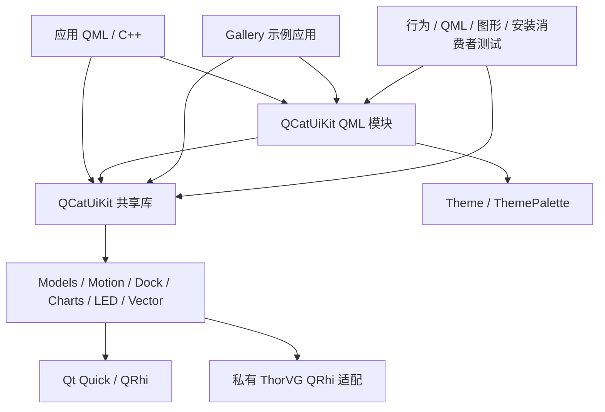

# QCatUiKit Existing Architecture Design

## Context and Status

本文记录 QCatUiKit 当前已实现的项目架构，是项目自定义的架构基线文档。它不属于某个 change 的规划产物，OpenSpec 的 change 状态命令不跟踪本文件；后续具体变更的设计仍位于 `changes/<变更名称>/design.md`。

描述依据为当前源码、构建配置及已有架构文档。本文不倒推历史设计动机，不把现有实现称为待实施方案，不新增实现任务。代码行为以源码为准，接口说明见 [文档索引](../src/uikit/doc/README.md)，基线覆盖范围见 [OpenSpec 索引](README.md)。

## Goals and Non-Goals

本文记录库、QML 组件、示例应用与验证工具的职责边界，说明当前数据流、线程与生命周期、公开接口和部署方式，为后续 change 定位影响范围提供上下文。

本文不规定新的架构目标，不提出重构方案，不替代完整 API 文档，不将全部公开接口声明为已逐项审计，不将历史验证结果当作本轮执行结果。

## System Structure



图中数据子系统是库内部职责分区，不是各自独立发布的共享库；Models、Motion 等非图形能力不要求经过 QRhi。

| 层次 | 当前职责 | 入口 |
| --- | --- | --- |
| 应用层 | 业务状态、外部数据、传感器、协议与持久化策略 | 使用库的宿主应用 |
| QML 组件层 | 外观、交互、主题绑定、专用功能呈现 | `src/uikit/qml/` |
| C++ 能力层 | 数据模型、控制器、图表数据、LED 工作流、矢量状态 | `src/uikit/<module>/` |
| 图形适配层 | Qt Quick 集成、QRhi 资源、ThorVG 适配 | 私有渲染类与 `adapters/qcatthorvgqrhi/` |
| 示例层 | 组件目录、导航、翻译、模拟数据与压力演示 | `examples/uikit/gallery/` |
| 验证层 | 行为协议、QML 交互、GPU 像素及安装消费者检查 | `tests/auto/`、`tools/` |

## Module Responsibilities

| 模块 | 当前职责 | 边界 |
| --- | --- | --- |
| core | 已加载库的版本、渠道与 ABI 身份 | 不执行二进制兼容检测 |
| theme | 配置生成语义 tokens，默认与局部主题 | 不自动按窗口大小选择密度 |
| models | TableModel、ChatModel、TreeModel | 不负责视图布局、网络和数据库 |
| motion | 四元数输入、校准、映射、授权与超时 | 不采集传感器，不发送飞控协议 |
| docking | 面板注册、布局树、浮动、回停与快照 | 业务内容状态由应用持有 |
| charts | 二维/三维数据、坐标轴、统计、交互和呈现 | 不负责业务数据采集 |
| led | 布局、效果、预设、独立播放、混合及输出映射 | 内存输出不等于硬件接收 |
| vector | SVG/Lottie 加载、画布、播放及渲染状态 | 无网络文档下载和 CPU 渲染回退 |

各模块对应 [specs](README.md#按能力组织)。UI 控件并非所有都与 C++ 目录一一对应：基础控件使用 Qt Templates，专用控件组合所属模块能力。

## Public Interfaces and Packaging

### QML and C++ Entry Points

库通过 `qt_add_qml_module` 构建共享模块，URI 为 `QCatUiKit`、QML 版本为 1.0，资源前缀为 `/qt/qml`。应用通过 `import QCatUiKit` 使用公开 QML 类型，通过 `QCatUiKit::QCatUiKit` CMake 目标链接 C++ 接口。

真实 C++ 公开头分布于模块目录；安装接口仍为扁平 `QCatUiKit` 包含目录，并提供带扩展名和不带扩展名的类名转发头。公开头名单及转发关系在 `src/uikit/CMakeLists.txt` 中显式登记。

TreeModel 和版本信息单例的 C++ 实现为私有。SurfaceImpl、Dock 内部类型、控件子对象树及 Gallery helper 不属于公开 API。

### Binary and Behavioral Boundaries

主要公开状态类采用 Qt 基类与 Pimpl 保存状态；公开值类型仍具有独立布局约束，包含 LED Position、二维样本和三维点。Pimpl 不提供跨编译器、运行库或 Windows Debug/Release 混用兼容。

库当前数字版本为 1.0.0，ABI/SOVERSION 为 1，默认渠道为 experimental。编译配置和发布渠道相互独立。CMake 的 SameMajorVersion 包匹配不执行 ABI 检测，渠道也不是兼容性证明。

部署单元包括库、QML 插件、qmldir、类型信息、QML 文件与资源，并依赖兼容 Qt。详细兼容边界见 [ABI 文档](../src/uikit/doc/ABI.md)。

## State and Data Flows

### Theme and Basic Controls

```text
ThemePalette 配置 / overrides --> tokens --> QML 属性绑定 --> 控件外观与隐式尺寸
```

Theme 是每个 QML 引擎的默认单例。局部 ThemePalette 由调用方持有并显式传递；已组合的控件继续向其内部控件传递主题。主题不遍历任意应用对象树。

基础控件通过 Qt Templates 保留基类输入、焦点和状态协议，再定义视觉呈现。主题 tokens 影响推荐隐式尺寸，应用显式尺寸与布局约束仍可覆盖结果。

### Models and Views

```text
应用记录 --> TableModel / ChatModel / TreeModel --> Qt 模型通知 --> 视图与 delegate
```

TableModel 使用表格模型，ChatModel 使用列表模型，TreeModel 提供只读层次快照。模型负责数据与通知；列宽、选择、滚动及业务发送由视图或应用管理。get 返回副本，不作为可直接修改的模型引用。

### Motion

```text
应用完成坐标转换的姿态 + 单调时间 --> TiltController
    --> 校准 / 滤波 / 映射 / 授权 / 超时 --> 预览值与有效控制快照 --> 应用发送层
```

Ready 状态可更新预览，但只有 Active 的 outputValid 为 true。控制面板显示输入状态并发出用户请求；它不替应用完成实际授权或传感器采集。飞机姿态仪与设备控制姿态分离，避免将杆量输入当作飞机遥测。

### Docking

```text
面板稳定 ID --> DockController 布局树与浮动快照 --> CatDockWorkspace 几何与宿主
```

控制器管理布局状态，工作区管理现有面板的呈现。浮动和回停切换视觉父项，不重新创建业务内容。界面锁与面板交互权限由 QML 入口处理，直接控制器调用不受同一界面策略限制。

布局保存版本 2，同时读取版本 1。恢复先校验候选内容，再替换当前布局；快照保存布局及浮动几何，不保存面板业务数据。

### Charts

```text
序列 / 坐标轴 / 样式 --> GUI 布局和图元快照 --> 数据绘制层
交互 / 标签 / 委托 --------------------------------> 独立覆盖层
```

二维数据绘制支持 QRhi 和 software 路径。三维使用独立 XYZ、网格和场景模型，不借用二维样本的 value 表示 Z；三维不提供 software 回退。

GUI 侧准备不可变绘制数据；渲染侧消费快照，避免直接读取应用 QObject 状态。数据层与文字/交互覆盖层分离。PNG 导出依赖可见窗口和异步图像捕获，其成功不构成平台像素一致性保证。

### LED

```text
Layout + Provider / 预设工作副本 --> Deck A / Deck B --> LightingFrame
    --> Mixer --> 最终 LightingFrame --> 预览颜色适配 --> LedSource --> LedPreview
                                    --> Patch 映射 --> OutputBackend
```

两个 Deck 持有独立播放工作状态，Storage 保存预设，LedProject 提供可选整体装配。实时帧使用不可变连续缓冲，低频配置通过 QObject/模型暴露。

RGB、RGBW 和 RGB_CW_WW 发光通道与 opacity 分离。混合按通道值执行，不做隐藏的 sRGB 线性化。预览亮度不会改变最终设备通道。旧 RGBA8 Source 接口与新管线并存，容量和身份契约分别校验。

### Vector

```text
sourceData / 本地 source / qrc 或 Canvas shapes
    --> 内容校验与加载 --> 渲染 --> 当前内容的状态 / 元数据 / 绘制计数
```

内存文档优先于 URL。GUI 线程读取文件，解析、动画求值、几何准备和最终绘制由当前矢量后端完成；GPU 路径不代表全部计算都在 GPU 上执行。

当前实现使用私有链接的 ThorVG 和本项目 QRhi 适配。加载反馈按当前内容版本接收，旧内容结果不覆盖新内容。Ready 表示成功记录绘制命令，不表示 GPU 已执行完成。

## Threading and Lifecycle

| 对象或阶段 | 当前执行边界 |
| --- | --- |
| 常规 QObject 属性、模型与控制器 | 对象所属线程 |
| 应用后台数据准备 | 准备批次后交接到对象线程，不并发修改模型容器 |
| LED Source 提交与快照 | 明确提供线程安全接口；外部生产者先停止再析构 Source |
| LED 效果与输出 | 有界后台效果作业与独立输出调度；取消状态属于输出事务 |
| GUI 与渲染交接 | 通过同步后的不可变快照传递数据 |
| QRhi 资源 | 归属对应渲染环境，设备变化时重建，不跨 QRhi 复用 |
| Dock 浮动宿主 | 与原工作区共享控制器和面板注册，工作区销毁时清理宿主 |

TiltController 超时依赖事件循环，不是硬实时保障。Vector 隐藏或窗口未暴露时不推进动画时钟。持有旧帧的读取方不修改不可变数据，但旧采样信号在应用队列中的时效仍由消费方判断。

## Build and Dependency Structure

根 CMake 配置依赖、版本、渠道、examples 和测试开关；模块 CMake 登记公开头、源码、QML 文件、插件与安装产物。

最低配置为 CMake 3.24、C++17、Qt 6.8，图形实现使用匹配的 GuiPrivate。默认启用 ThorVG，相关工具和下载缓存由构建辅助配置管理；源码、下载及工具缓存不是库的运行时 API。

Gallery 是内部静态 QML 模块 `QCatUiKit.Gallery` 加可执行程序。关闭 examples 不移除安装库的公共组件。关闭测试不要求 Qt Test/QuickTest，但也不会获得对应测试结果。

详细接入命令和平台依赖见 [构建文档](../src/uikit/doc/BUILDING.md)。

## Validation Structure

| 验证类别 | 检查对象 | 不代表什么 |
| --- | --- | --- |
| C++ 行为测试 | 模型协议、输入校验、状态机、数据与版本 | 不证明 UI 或 GPU 绘制 |
| QML 测试 | 属性、交互、焦点、生命周期与视觉状态 | 不自动覆盖全部组件和平台 |
| 原生图形测试 | 真实窗口中的像素、资源与播放 | 不代表全部驱动或设备 |
| Gallery 测试 | 页面装配、示例与翻译 | 不将 helper 变为库 API |
| 安装消费者与 ABI 检查 | 安装头、包发现、导出与已编译消费者 | 不证明全部符号和工具链 |
| 文档与 OpenSpec 校验 | 链接、文档规则和规约结构 | 不证明业务行为符合规约 |

GPU 套件按选项注册，默认普通 CTest 结果不包含全部图形验收。方法见 [VALIDATION](../src/uikit/doc/VALIDATION.md)，执行证据记录在对应 OpenSpec change 中并随变更归档。

## Known Constraints and Technical Debt

- 首轮 specs 覆盖不完整，详细缺口保留于覆盖索引；本文件不将缺口转换为已完成审计。
- Qt 私有图形 API、QRhi 和 Wayland 桥接使图形与原生拖动依赖具体 Qt 版本和平台能力。
- 二维图表具备 software 路径，三维、LED 和 Vector 的回退支持不同，不能用统一后端假设调用它们。
- Vector 文件读取占用 GUI 线程，无加载超时；缺少渲染机会时可持续 Loading。
- 模型无自动淘汰策略，演示容量不代表库容量保证。
- LED 白光预览为近似；内存接收与诊断均不等于真实硬件确认。
- Dock 浮动宿主不支持内部四方向分割，不能在独立工作区之间拖动。
- API 文档、基线和源码描述不同层次；现有工具不自动验证三者所有语义一致。

## Relationship to Future Changes

当前模块行为写入 `specs/<能力>/spec.md`；本文件保存跨模块架构上下文。后续 change 的 proposal 描述问题和范围，差异 specs 描述目标行为，design 解释该次技术选择，tasks 列实施及验证工作。

单次变更只有实际改变项目架构时才更新本文对应内容。新增设计不能提前写成已实现架构；既有技术债也不因记入本文而自动成为实施授权。

## Source References

- [根构建配置](../CMakeLists.txt)、[模块构建与公开头登记](../src/uikit/CMakeLists.txt)。
- [已有架构文档](../src/uikit/doc/ARCHITECTURE.md)、[维护入口](../src/uikit/doc/MAINTENANCE.md)。
- [主题](../src/uikit/doc/THEMING.md)、[模型](../src/uikit/doc/MODELS.md)、[体感](../src/uikit/doc/ATTITUDE.md)。
- [Dock](../src/uikit/doc/DOCKING.md)、[图表渲染](../src/uikit/doc/CHART_RENDERING.md)。
- [LED 工作流](../src/uikit/doc/LEDWORKFLOW.md)、[矢量](../src/uikit/doc/VECTOR.md)。
