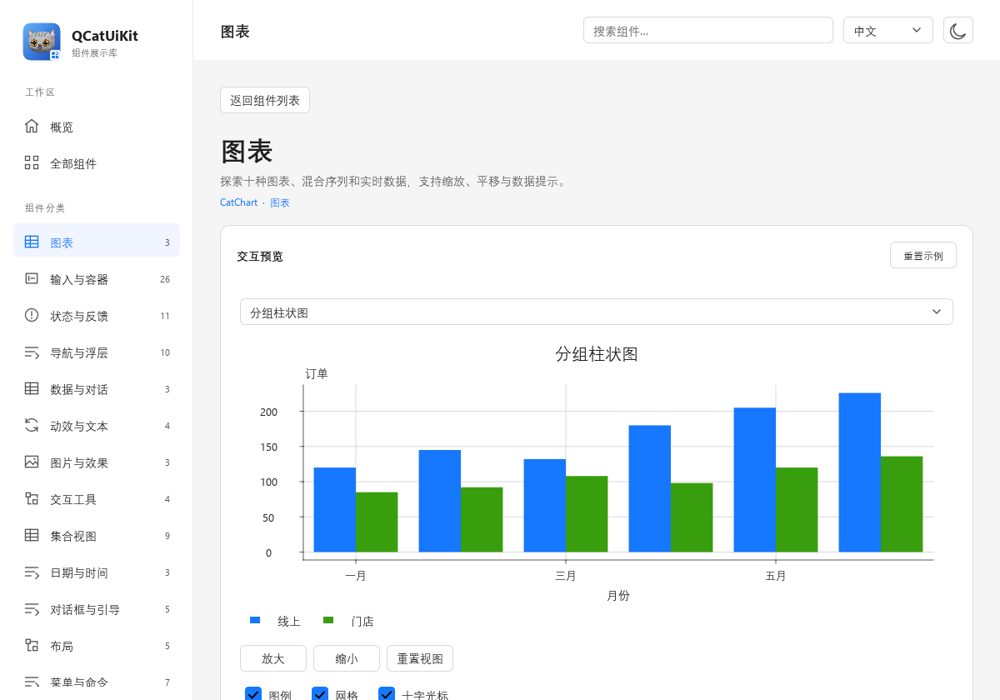

# 原生图表

[文档索引](README.md) · [Gallery 使用指南](../../../examples/uikit/gallery/README.md)

用 `CatChart` 显示图表，用 `CatChartSeries` 提交数据，通过 `xAxis`／`yAxis` 设置坐标范围。应用可以组合多条系列，支持缩放、选择、实时更新和 PNG 导出。

图表在 GPU 后端使用私有 QQuickRhiItem 绘制数据，Qt Quick 合成文字和交互层；二维也提供软件回退。随共享库和 QML 模块一起安装，支持 Qt 6.8+、C++17，无需 Qt Charts、Qt Graphs 或 WebEngine。

私有 QQuickRhiItem 数据层已接入十种基础二维图表，支持阶梯／样条曲线、虚线、显式断点、区间面积、四种预设及纹理标记、六种柱状布局，以及局部／分离饼图和多层同心环。扩展适配器提供气泡与色带映射、格网／滚动热力图、雷达增强、等高线／填色区域、OHLC／成交量、箱线／离群点，见 [扩展图表](CHARTEXTENSIONS.md)；普通／百分比堆叠面积、直方图、公共线性拟合／残差带与瀑布图见 [统计图表适配器](CHARTSTATISTICS.md)。`scene3D` 提供三维场景，三维数据、相机、Blinn–Phong／Phong 材质及图表见 [三维图表](CHARTS3D.md)。图层、缓存、线程和未覆盖能力见 [图表渲染架构与边界](CHART_RENDERING.md)；本页描述当前已实现接口。

## 按任务查找

| 想完成的操作 | 阅读位置 |
| --- | --- |
| 创建第一张图、提交或追加数据 | [入口](#入口)、[数据与图表类型](#数据与图表类型) |
| 改曲线、标记、虚线或填充 | [曲线与点标记](#曲线与点标记)、[虚线与显式断点](#虚线与显式断点)、[面积外观](#面积基线与填充外观) |
| 显示上下界或统计结果 | [区间面积](#区间面积)、[统计图表](CHARTSTATISTICS.md) |
| 配置坐标轴、平移与缩放 | [坐标轴与刻度](#坐标轴与刻度)、[框选缩放](#框选缩放)、[触摸交互](#触摸平移与双指缩放) |
| 选中记录或自定义显示 | [选择与拾取](#选择与拾取)、[QML 委托](#自定义-qml-委托) |
| 保存当前图为图片 | [图像导出](#图像导出) |
| 排查性能或运行演示 | 文末的 [Gallery](#gallery-数据操作与压力测试) 与 [渲染诊断](#渲染与验证) |



[中文暗色窄屏预览](images/gallery-charts-mobile.png)

以上截图保留合计 1,000,000 条原始记录，以采样概览绘制；[截图环境与生成方法](SCREENSHOTS.md)。

## 入口

| 类型 | C++ 类 | 公开头 |
| --- | --- | --- |
| CatChart | QCatUiKit::ChartItem | QCatUiKit/qcatchartitem.h 或 QCatUiKit/ChartItem |
| CatChartAxis | QCatUiKit::ChartAxis | QCatUiKit/qcatchartaxis.h 或 QCatUiKit/ChartAxis |
| CatChartColorScale／Bubble／Grid／Contour／Ohlc／BoxPlot | 对应 ChartColorScale 等 C++ 类 | 见 [扩展图表入口表](CHARTEXTENSIONS.md) |
| CatChartFit | QCatUiKit::ChartFit | QCatUiKit/qcatchartfit.h 或 QCatUiKit/ChartFit |
| CatWaterfall | QCatUiKit::ChartWaterfall | QCatUiKit/qcatwaterfall.h 或 QCatUiKit/ChartWaterfall |
| CatChartStack | QCatUiKit::ChartStack | QCatUiKit/qcatchartstack.h 或 QCatUiKit/ChartStack |
| CatHistogram | QCatUiKit::ChartHistogram | QCatUiKit/qcatcharthistogram.h 或 QCatUiKit/ChartHistogram |
| CatChartSeries | QCatUiKit::ChartSeries | QCatUiKit/qcatchartseries.h 或 QCatUiKit/ChartSeries |

```qml
import QtQuick
import QCatUiKit

CatChart {
    width: 640; height: 360
    title: qsTr("每周订单")
    chartType: CatChartSeries.Bar
    xAxis.scale: CatChartAxis.Category
    xAxis.categories: [qsTr("周一"), qsTr("周二"), qsTr("周三")]
    CatChartSeries {
        id: orders
        name: qsTr("订单")
        Component.onCompleted: setData([{x: 0, y: 12}, {x: 1, y: 18}, {x: 2, y: 9}])
    }
}
```

C++ 调用方链接 `QCatUiKit::QCatUiKit`。可以直接将 ChartItem 加到 QQuickWindow 的 contentItem，数据与计算不需要 QML 引擎。

下面是已创建 `QQuickWindow window` 后的调用片段；应用仍需创建 QGuiApplication、显示窗口并运行事件循环：

```cpp
#include <QCatUiKit/ChartItem>
#include <QQuickWindow>

auto *chart = new QCatUiKit::ChartItem(window.contentItem());
chart->setSize({640, 360});
auto *series = new QCatUiKit::ChartSeries(chart);
series->setName(QStringLiteral("Signal"));
chart->addSeries(series);
series->appendSamples({{0, 2, 1, {}}, {1, 4, 1, {}}});
```

## 数据与图表类型

| ChartSeries::Type | 数据解释 |
| --- | --- |
| Histogram = 15 | 由 CatHistogram 生成，按实际箱边界绘制；详见统计适配器 |
| Waterfall = 16 | 由 CatWaterfall 生成，按累计起止值绘制；支持小计／总计和连接线 |
| Candlestick = 17／Ohlc = 18 | CatChartOhlc 生成的 K 线／OHLC 刻线 |
| BoxPlot = 19 | CatChartBoxPlot 生成的箱体、中位线和须 |
| Grid = 20 | CatChartGrid 数值纹理／稀疏单元 |
| Contour = 21 | CatChartContour 生成的等值线／填色三角形 |
| Inherit = −1 | 使用图表 chartType，序列默认值 |
| Line = 0 | XY 折线；保留可见范围峰谷 |
| Area = 1 | XY 面积填充至零线；多系列重叠，不是堆叠面积 |
| Bar = 2 | 分组柱状；X 为位置，Y 为高度；组宽 0.8 X 单位 |
| StackedBar = 3 | 同一 X 的正值、负值分别累计 |
| Scatter = 4 | XY 散点 |
| Bubble = 5 | XY 位置；value 为逻辑像素半径，限制为 1–64 |
| Pie = 6 / Doughnut = 7 | 默认第一条可见系列；Doughnut 可启用 multiRing；Y 为非负权重，非正值忽略；label 为扇区名 |
| Radar = 8 | 索引对应维度，最多 32 维；非负值，标签取 xAxis.categories |
| Heatmap = 9 | XY 为单元中心，value 为强度；cellWidth/cellHeight 为数据坐标尺寸 |
| PercentBar = 10 | 纵向百分比堆叠；同一 X 的正负值分别归一化 |
| HorizontalBar = 11 | 横向分组；原始 X 为分类，Y 为数值 |
| HorizontalStackedBar = 12 | 横向正负分离堆叠；原始数据格式不变 |
| HorizontalPercentBar = 13 | 横向百分比堆叠；原始数据格式不变 |
| RangeArea = 14 | 通过专用上下界入口输入成对 X/lower/upper，填充两条边界之间的区间 |

单条序列可覆盖笛卡尔图表的默认 type，例如柱状与折线、散点与拟合线。径向类型由图表 chartType 决定，不支持与笛卡尔类型混合。热力图自动统计强度范围并显示色条；数据应由应用准备，不包含音频采集、解码或 FFT。

序列默认容量 100,000，满后覆盖最旧点。QML 提供 `append(x,y,value)`、`appendData([{x,y,value,label}])`、`setData(...)`、`at(index)` 和 `clear()`；value/label 可省略。C++ 还提供 `appendSamples`、`replaceSamples`、`replacePoints`、`sampleAt`、`sortedX`、`lowerBound`。包含 NaN、Infinity 或缺少坐标的批次整批拒绝，保留原数据。数据可以无序；有序时可二分定位。

所有对象 API 在其所属线程调用。工作线程将完整批次通过 queued connection 提交；追加／替换在其他线程调用会返回 false。`sampleAt` 的引用不能跨修改保留。`addSeries` 不转移 QObject 所有权；C++ 调用方管理系列，或将图表作为父对象。移除、清空和销毁系列会断开连接。

`displayBudget` 默认每条曲线 2,048，0 关闭概览采样，其他有效值至少为 8。数据始终完整保留；有序 X 的直线／阶梯／样条 Line、Area 超过预算后使用曲段层次索引（LOD，按当前可见细节选择绘制量）：按当前轴坐标和视口宽度选取首尾点及真实曲线峰谷，分别处理每个连续段，避免跨断点连线。分组锚定原始数据，固定缩放比例下平移仅改变映射和边缘裁剪，不因可见范围起点变化而重新选择内部标记点；缩放后自动展开细分，细节处仍绘制原始曲段。预算为目标而非顶点硬上限，断点数量、曲线过冲及细分会增加实际绘制量。

样条控制点与层次索引不随平移、缩放、尺寸、颜色或线宽变化重建；数据、断点、轴 scale、曲线模式／张力或实际图表类型变化才使对应系列缓存失效。视口使用固定轴范围时跳过全量自动极值统计。索引边界包含控制多边形，保留从可见 X 范围之外过冲进入绘图区的曲段。概览中的点标记只显示代表性原始节点；命中先定位概览对应源曲段，再用原始曲线检查，返回原始记录而非概览极值。虚线沿当前显示路径计算相位。

有序 Line／Area／RangeArea 的全部七种曲线模式使用层次采样；区间上下界控制点和极值索引共同缓存。无序 X 不使用该层次采样。首次建立索引和数据更新仍需处理全量记录，持续大批次更新不等同于静态数据平移性能。大量柱状、散点或单元格应由应用控制数据量，或明确提供聚合概览。

## 曲线与点标记

`CatChartSeries.curveMode` 用于 Line、Area 和 RangeArea，枚举值如下；Area 仍填充至既有基线，不改变原始数据。

| CurveMode | 行为 |
| --- | --- |
| LinearCurve = 0（默认） | 原始节点之间直线连接 |
| StepLeft = 1 | 在前一节点 X 处跳变，中间平台取后一节点 Y |
| StepRight = 2 | 在后一节点 X 处跳变，中间平台取前一节点 Y |
| StepCenter = 3 | 在两节点轴坐标的中点跳变 |
| MonotoneSpline = 4 | 保形三次 Hermite 插值；递增 X 区间使用加权调和斜率，抑制过冲 |
| CatmullRomSpline = 5 | 均匀参数 Catmull-Rom；`splineTension` 在 0–1 之间，0 为完整切线，1 为直线轨迹 |
| NaturalSpline = 6 | 自然参数三次样条；内部二阶连续，首尾二阶导数为零 |

所有曲线按源记录顺序连接，不自动排序。阶梯保留重复 X 的垂直跳变；MonotoneSpline 在重复／递减 X 的段上回退直线。NaturalSpline 和 CatmullRomSpline 按记录参数插值，允许回折和过冲；自动轴范围包含曲线实际极值。空序列不绘制，单节点仅在启用点标记时可见，双节点样条为直线轨迹。对数轴先变换再插值，因此中心阶梯在对数 X 轴上的跳变位置为几何中点；无效对数节点切断曲线。

样条按屏幕误差自适应细分，目标为 0.35 个物理像素，每段最多递归 10 层；达到上限时不再细分。拾取使用相同细分路径。阶梯平台返回所属原始记录；样条返回该段最近的原始端点，查询始终保留原始 index/x/y，不将插值点伪装成源记录。Line／Area 距离原始节点 18 个逻辑像素以内时优先返回原始节点；RangeArea 使用下述区间拾取约定。

| 属性 | 默认值与范围 | 适用范围 |
| --- | --- | --- |
| markerShape | Circle = 0、Square = 1、Triangle = 2、Diamond = 3、TextureMarker = 4；默认 Circle | Scatter、Bubble、Line／Area 的点标记 |
| markerSize | 默认 8，范围 1–128，逻辑像素外接框尺寸（圆形为直径） | Scatter、Line／Area 的点标记 |
| markersVisible | 默认 false | 是否显示 Line／Area 的原始数据节点 |
| splineTension | 默认 0，范围 0–1 | 仅 CatmullRomSpline |

Bubble 继续使用每条记录的 `value` 作为逻辑像素半径（1–64），不使用 markerSize。散点和气泡按实际形状命中，菱形、三角形和圆形外接框的空角不会命中；Line／Area 仍保留上述曲线查询半径。无效枚举、越界尺寸／张力和非有限数不改变当前设置；样式变更发出 `styleChanged`。预设标记与 TextureMarker 使用共享四边形实例化，纹理失败时回退方形；细节见“实例化与纹理标记”。

```qml
CatChart {
    width: 640; height: 360
    CatChartSeries {
        curveMode: CatChartSeries.NaturalSpline
        markersVisible: true
        markerShape: CatChartSeries.Diamond
        markerSize: 10
        Component.onCompleted: setData([{x: 0, y: 2}, {x: 1, y: 5}, {x: 2, y: 3}])
    }
}
```

## 虚线与显式断点

Line／Area 及 RangeArea 边框支持以下样式；虚线只改变边框，不打断面积填充或删除源记录。

| 属性 | 默认值与约束 |
| --- | --- |
| strokeStyle | SolidLine = 0；DashLine = 1 |
| dashPattern | 默认 `[8, 4]`；偶数项，2–32 项，每项 1–1024 个逻辑像素；交替表示线段和空隙 |
| dashOffset | 默认 0，范围 −1e9 至 +1e9 个逻辑像素；正值表示从图案内相应位置开始 |
| fillOpacity | 默认 65/255，范围 0–1；Area／RangeArea 填充的不透明度，与填充色及渐变末端的 alpha 相乘；边框和标记不受影响 |

虚线按映射后的屏幕弧长切分，跨原始节点、阶梯拐角和样条细分点连续计相位；每个可见连续段的起点重新应用 dashOffset。间距不随数据缩放放大，DPR 由渲染层处理。AutoCap 的虚线默认使用平端点，可通过 lineCap／lineJoin 显式指定端点和连接样式。它与 [Qt Graphs LineSeries](https://doc.qt.io/qt-6/qml-qtgraphs-lineseries.html) 以线宽为单位的 dashPattern 约定不同。虚线间隙仍可按曲线查询半径拾取原始记录。

普通 QML 批次可加 `breakBefore: true`，表示当前记录与前一条记录之间断开。`setBreakBefore(index, bool)` 可修改现有记录；`breakBefore(index)` 和只读 `hasBreaks` 可查询。字段必须为布尔值；NaN／Infinity 仍整批拒绝，未提供 NaN 适配入口。

```qml
CatChart {
    width: 640; height: 360
    CatChartSeries {
        curveMode: CatChartSeries.NaturalSpline
        strokeStyle: CatChartSeries.DashLine
        dashPattern: [16, 8]
        Component.onCompleted: setData([
            {x: 0, y: 2}, {x: 1, y: 4},
            {x: 3, y: 1, breakBefore: true}, {x: 4, y: 3}
        ])
    }
}
```

断点适用于所有 Line／Area 曲线模式和 RangeArea。曲线、面积填充、插值邻点与拾取路径不会跨越断点；断点两侧的原始端点仍可查询。环形覆盖和缩容保留剩余记录的断点信息，第一条记录的标记没有前向连接可断开。普通 C++ `appendSamples` 追加的记录默认没有断点，`replaceSamples`／`replacePoints` 替换为无断点数据；QML 批次和区间批次使用各记录自带标记。修改标记发出一次 dataChanged；无效索引或跨线程调用返回 false。

## 面积基线与填充外观

Area 的 `areaBaselineMode` 默认 `ZeroBaseline = 0`，仍填充至零值；另有 `CustomBaseline = 1` 和 `PlotBottomBaseline = 2`。`areaBaseline` 默认 0，接受任意有限 double，仅在 CustomBaseline 下生效。自动 Y 范围包含有有效数据的可见 Area 系列的零值／自定义基线；绘图区底部模式只使用数据范围。空系列不扩展范围。手动范围不受基线影响，越界基线夹至对应绘图区边缘。对数 Y 轴无法表示零值／负值基线时，回退至可见范围下限；正值自定义基线正常参与自动范围。RangeArea 使用成对下界，忽略这两个基线属性。

Area 和 RangeArea 共用以下填充属性；不影响其他图表类型、源数据或拾取规则：

| 属性 | 默认值与语义 |
| --- | --- |
| fillColor | 无效 QColor，自动继承系列 color／图表调色板；显式颜色独立于边框 |
| borderColor | 无效 QColor，自动继承系列颜色；仅控制曲线边界，不沿基线或左右端点补画封闭边框；透明色可隐藏边界 |
| fillStyle | SolidFill = 0；VerticalGradient = 1、HorizontalGradient = 2 |
| fillEndColor | 无效 QColor，继承有效 fillColor；仅渐变模式使用 |
| fillOpacity | 默认 65/255，0…1；分别乘两个端点的 alpha，不改变边界及数据标记 |

渐变为两个端点，垂直方向从绘图区顶部到底部，水平方向从左到右；均以当前整个绘图区为基准，缩放后重新映射，不以每条三角形、每段数据或每个系列的包围框为基准。颜色按预乘 alpha 插值；先裁剪面积几何再计算顶点颜色，保证越界曲线不会拉平渐变。支持透明末端；多停止点和纹理选项见下文。

填充支持最多 32 个严格递增的 `fillGradientStops`，每项是 `{position: 0..1, color: ...}`。空数组恢复 fillColor / fillEndColor 双色渐变；至少提供两个停止点，非有限数、重复／逆序位置或无效颜色整批忽略。首尾停止点之外延用端点色。停止点以绘图区为参照，插值采用预乘透明度；几何在停止点处分割，避免一个三角形跨过多个色段时漏掉中间颜色。

`fillStyle: CatChartSeries.TextureFill` 使用 `fillTexture` 本地文件或 qrc URL，QML 相对路径相对于组件文件解析。图片最长边 4096 像素，仅在 URL 变化时同步读取；不发网络请求。`fillTextureMode` 默认为 StretchTexture，图片铺满绘图区；TileTexture 以 `fillTextureSize`（默认 32×32，宽高各 1–4096 逻辑像素）从绘图区左上角平铺。图片保留原色与透明度，再乘 fillOpacity；边框保持独立。缺失／无效图片回退到系列填充色，并通过只读 `fillTextureError` 报告，清空 URL 可清除错误。修改同一路径文件后需先清空再重设 URL 以重载。

纹理快照只含不可变 QImage 和绘制命令，渲染线程管理 QRhi 纹理、采样器、绑定和释放。平移、改变平铺尺寸及静止重绘复用图片，不重复上传；`renderingStatistics().textureUploads` 可检查累计纹理上传次数。软件回退支持相同填充语义。

线端与连接通过系列 `lineCap`（AutoCap / FlatCap / SquareCap / RoundCap）、`lineJoin`（AutoJoin / BevelJoin / MiterJoin / RoundJoin）和 `miterLimit` 设置，适用于 Line、Area 与 RangeArea 两条边界。`miterLimit` 默认 4，有限输入限制在 1–16，单位为整条线宽；过长尖角按该长度截断。虚线的每段使用所选线端，连续节点不重置相位，显式断点重置相位。圆头、方头会向两端延伸半线宽，因此短间隔可能被覆盖。抗锯齿宽度随 DPR 调整。

默认 AutoCap + AutoJoin 保留既有逐段几何路径；需要连续连接外观时显式设置 join 或 cap。显式路径中 AutoCap 为实线方头／虚线平头，AutoJoin 为斜角。连续路径整体描边和三角化，半透明连接处不因相邻线段重复叠色。大规模有序曲线继续先做视口 LOD，再生成描边；样式不改变原始记录和拾取值。

边框继续使用 lineWidth、strokeStyle、dashPattern 和 dashOffset。Area 的数据标记、图例颜色仍取系列 color；显式填充色和边界色不改写 color。曲线穿过基线、区间上下界交叉时拆分几何，断点不连面；多个系列按声明顺序透明叠加。无效枚举／非有限基线被忽略，设置变更使用既有 styleChanged 信号。C++ 传入无效 QColor 可恢复继承。

```qml
CatChart {
    width: 640; height: 360
    chartType: CatChartSeries.Area
    CatChartSeries {
        name: qsTr("信号面积")
        areaBaselineMode: CatChartSeries.CustomBaseline
        areaBaseline: 2
        fillStyle: CatChartSeries.VerticalGradient
        fillColor: "#22b8cf"
        fillEndColor: "transparent"
        fillOpacity: 0.8
        borderColor: "#5265e8"
        curveMode: CatChartSeries.MonotoneSpline
        Component.onCompleted: setData([{x: 0, y: 4}, {x: 1, y: -2}, {x: 2, y: 6}])
    }
}
```

## 区间面积

`RangeArea` 使用新的成对数据入口，既有 `Sample` 和 `value` 的含义保持不变：

- QML：`setRangeData([{x, lower, upper, label, breakBefore}])` 与 `appendRangeData(...)`；label、breakBefore 可省略。
- C++：`RangeSample { double x, lower, upper; QString label; bool breakBefore; }`，通过 `replaceRangeSamples`／`appendRangeSamples` 提交。
- 三个数值必须有限；缺失字段、非有限值或非布尔断点使整批失败，源数据不变。成对入口的上下界共用 X；独立数组使用 setRangeBoundaries 并显式选择严格对齐或插值。
- `hasRangeValue(index)`／`lowerValue(index)` 查询附加边界。普通记录没有下界，lowerValue 返回 NaN；RangeArea 跳过这种记录并断开前后连接，不补造零基线。

两条边界共用 `curveMode` 和 `splineTension`，支持直线、左／右／中心阶梯、单调／Catmull-Rom／自然三次样条。默认直线行为保持不变；markersVisible 不适用于 RangeArea。原始顺序不变，重复 X 可画垂直边界，单调样条在重复／递减 X 的段上回退直线。上下界名称代表输入边界，不按大小交换。

上下界在同一参数位置一起细分，任一边界未达到屏幕误差目标就继续分割；填充、边框和拾取使用相同分段。在细分路径交点拆分填充，避免交叉产生错误三角形或重复透明度。NaturalSpline／CatmullRomSpline 允许回折，回折导致的区域重叠按绘制顺序混合。自动范围同时包含两条边界的实际曲线极值；即使原始端点在可见 X 范围外，也保留可能过冲进入视野的曲段。有序区间带使用上下边界共享的分层区间 LOD，保留两侧极值；无序数据精确遍历，displayBudget=0 可关闭 LOD。

对数轴先变换再拟合；任一边界无效或缺少下界时整对记录断开，breakBefore 同时隔离两条边界的插值邻点。自然样条按每个连续有效区间单独求解，不跨断点拟合。lineWidth、borderColor（默认继承 color）、strokeStyle 控制两条边框；虚线相位沿各边界连续，断点处重新开始。填充支持独立颜色、透明度与双色渐变。

`at()` 保留 x/y/value/label，并对区间记录附加 lower/upper；y 等于原始 upper，value 保持默认 1。`dataAt()` 在带内或边界 6 个逻辑像素内命中，返回原始记录、lower/upper 和 `boundary: "lower" | "upper"`，结果 y 对应被选中的边界。直线按 X 位置选择较近端点；阶梯平台返回所属记录；样条按原始曲段参数的前／后半段选择端点，不按某条细分小线段重新选择。两边等距时优先 upper。默认提示显示命中值和两条原始边界；不将插值坐标作为源数据返回。

```qml
import QtQuick
import QCatUiKit

CatChart {
    width: 640; height: 360
    chartType: CatChartSeries.RangeArea
    CatChartSeries {
        name: qsTr("温度区间")
        curveMode: CatChartSeries.NaturalSpline
        fillOpacity: 0.3
        Component.onCompleted: setRangeData([
            {x: 0, lower: 16, upper: 24}, {x: 1, lower: 18, upper: 27},
            {x: 3, lower: 17, upper: 25, breakBefore: true},
            {x: 4, lower: 19, upper: 26}
        ])
    }
}
```

### 独立上下边界的对齐

区间面积也可调用 `setRangeBoundaries(lower, upper, alignment)`，两数组各项使用 `{x, y, label?, breakBefore?}`。两个数组都必须严格递增且 X 唯一。默认 ExactAlignment 要求数量和每个 X 完全一致，否则返回 false 并保留旧数据。LinearAlignment 在共同覆盖范围内取 X 的并集，按数据坐标线性插值，不外推；插值后的成对记录再应用 curveMode。重复／无序 X、非法数值、单侧空数组、无共同范围均拒绝；两侧均空表示清空。对齐是一次快照转换，at() 返回生成后的成对记录，capacity 仍保留末尾记录。

插值不穿过任一边界的 breakBefore 区间：缺失区间内无法配对的 X 被跳过，下一个有效配对点保留断点；一侧的断点同时隔离上下边界和填充。精确节点标签优先取上界，其次下界，纯插值节点没有标签。名称 lower／upper 在交叉后仍保持原意。

有序的大规模 RangeArea 在所有七种 curveMode 下共享分层区间索引，保留上下两边界的实际极值、首尾点及连续区间。小于显示预算对应屏幕宽度的区间才聚合；缩放到细节恢复原曲线。边界交叉仍拆分填充，断点隔离索引根节点。平移复用缓存，颜色／线宽／填充变化不重新拟合；数据、曲线算法或轴尺度变化会重建。LOD 拾取通过候选区间细查原始曲线，返回原始成对记录，不把聚合端点当成原值。无序数据保持精确遍历，displayBudget=0 可关闭 LOD。

## 饼图与同心环

Pie 与 Doughnut 默认仍只显示第一条可见系列，忽略非正 Y 值；`Doughnut + multiRing: true` 按添加顺序由外向内排列所有可见、非空系列。每环独立归一化，使用最大正值缩放求和，支持 `1e308` 等大权重。全零或全隐藏的非空系列保留空环；清空、移除或隐藏整个系列后，其余环重新均分可用厚度。

| CatChart 属性 | 默认值与约定 |
| --- | --- |
| pieStartAngle / pieEndAngle | 0 / 360 度；顶部为 0，顺时针。分别接受 −360…360 / −360…720；二者差必须在 0…360，否则不绘制 |
| setPieAngles(start, end) | 原子更新起止角；非法数值或跨度返回 false，保留原值。建议用此方法同时改变起点与跨度，避免中间状态 |
| pieRadius | 0.84，范围 0…1；先从绘图区短边的一半减去最大可见扇区分离距离，再乘此比例，得到外半径 |
| holeSize | 0.58，范围 0…1；Doughnut 中心孔相对外半径的比例，Pie 忽略。0 为无孔，1 不绘制 |
| multiRing | false；仅在 Doughnut 启用。各环共用角度与外径设置 |
| ringGap | 4 逻辑像素，范围 0…64；多环实际间距至多为总可用厚度除以环数的二分之一，防止间距挤掉全部环 |
| sliceLabelsVisible | true；标签总开关，单环还显示可容纳且数值有限的中心合计 |
| sliceLabelPosition | SliceLabelInside = 0（默认）显示内部百分比；SliceLabelOutside = 1 显示外置名称／百分比及彩色引线。非法枚举忽略并保留旧值 |

绘制、标签和拾取使用同一扇区几何。`dataAt` 附加 `ringIndex`（最外环为 0）及 `percentage`（本环可见正值中的百分比）；`seriesIndex` 与 `index` 仍指向源系列和记录。中心孔、环间空隙和局部角度外侧不可命中；分离扇区按移动后的中心拾取，重叠时取后绘制扇区。若绘图区太小，扣除分离预留后没有正半径，则不绘制。

`CatChartSeries.setSliceStyle(index, map)` **替换整份**扇区样式，`{}` 恢复默认；`sliceStyle(index)` 查询显式设置。支持：

| 样式字段 | 约定 |
| --- | --- |
| color | 有效 QColor／颜色字符串；省略时使用主题扇区调色板，与系列 color 独立 |
| borderColor | 有效颜色；省略时使用图表文字颜色 |
| borderWidth | 默认 0，范围 0…16 逻辑像素；实际宽度至多为环厚度的一半 |
| explodeDistance | 默认 0，范围 0…128 逻辑像素；沿该扇区角平分线向外移动 |
| labelVisible | 默认 true，布尔值；受图表 sliceLabelsVisible 总开关控制 |

未知字段、非法颜色、越界／非有限数值或非布尔标签值整份拒绝。无效索引和跨线程修改返回 false。QML 的 `setData`／`appendData` 也接受可选 `sliceStyle` 对象，非法样式使整个数据批次失败。`at(index)` 对已设置样式的记录附加 `sliceStyle`。样式保存在私有记录中，随容量覆盖和缩容保留；替换数据使用新记录的样式，普通 C++ Sample 默认无样式。单独改样式发出 styleChanged，不改变数据或扇区隐藏状态。

`setSliceVisible(seriesIndex, index, visible)` 与 `isSliceVisible(...)` 管理每张图独立的扇区显示状态；所有环的图例合计最多 64 项，多环图例加系列名。修改某系列数据恢复该系列全部扇区显示，其他环保持原状态；切换 chartType 清除所有扇区隐藏状态。此显示状态不等同于系列 visible。

内部标签按主题字体测量，放不进扇区或与已有标签重叠时省略。外置标签按角平分线分到左右两列，保留整数百分比，记录 label 过长时省略；多环加系列名。无名称时只显示百分比。文字使用图表 textColor，引线使用扇区颜色，起点跟随分离后的扇区外缘；内环引线在所有扇区上方绘制，可能穿过外环。

外置模式在绘图区左右各预留 `floor(min(160, 绘图区宽 × 0.23))` 逻辑像素的标签列及 18 像素引线空隙，上下各留 8 像素；在剩余矩形上按同样规则扣除最大分离距离、应用 pieRadius。关闭 sliceLabelsVisible 后恢复原始半径。宽度不足 180、列内放不下 `100%` 或高度不足两行时，省略外置标签并保留原始可绘制半径；不会自动改回内部标签。

每图按环／记录顺序最多尝试前 256 个可见、正值且启用标签的扇区。每列空间不足时优先保留本环占比较大的扇区，占比相同时保留较早记录；再按引线锚点高度排列，标签之间至少留 3 像素，完整限制在绘图区内。名称最多处理 1024 字符，多环系列名前缀最多 256 字符，换行／制表转为空格。省略标签不删除数据，图例与提示仍可读取记录；标签和引线不增加拾取区域。列布局完成后按占比优先保留互不交叉的引线，舍弃重叠、相交或自身折返的路线及其标签，保留原始数据和提示。标签支持有预算的 labelDelegate，详见下文。环的半径比例、间距与分离距离是 CatChart 自己的契约，不承诺与 Qt Graphs 同名属性的数值含义相同。

```qml
import QtQuick
import QCatUiKit
CatChart {
    width: 640; height: 480
    chartType: CatChartSeries.Doughnut
    multiRing: true; holeSize: 0.3; ringGap: 8
    sliceLabelPosition: CatChart.SliceLabelOutside
    pieStartAngle: -90; pieEndAngle: 180
    CatChartSeries {
        name: "Outer"
        Component.onCompleted: setData([
            {x: 0, y: 12, label: "A", sliceStyle: {color: "#1677ff", explodeDistance: 12}},
            {x: 1, y: 18, label: "B"}])
    }
    CatChartSeries {
        name: "Inner"
        Component.onCompleted: setData([{x: 0, y: 20, label: "A"}, {x: 1, y: 10, label: "B"}])
    }
}
```

## 六种柱状布局

纵向／横向分别支持分组、堆叠和百分比堆叠。同一分类按系列和记录顺序累计，正值与负值分别堆叠。隐藏系列后重新计算布局。六种布局共用实例化矩形以及以下宽度与外观设置。

| 对象／属性 | 默认值与约定 |
| --- | --- |
| CatChart.barGroupWidth | 0.8，范围 0…1，单位为分类轴坐标；分组时在可见、非空系列间等分槽位，堆叠时整组共用一个槽位 |
| CatChart.barSpacing | 0，范围 0…1；从每个槽位两侧等量留空，实际柱宽 = 槽宽 × (1 − barSpacing)，中心不变 |
| CatChartSeries.barBorderWidth | 0，范围 0…16 逻辑像素；边框在柱内，实际宽度不超过短边的一半 |
| barBorderColor | 未设时使用图表文字色；可设独立颜色，C++ 传无效 QColor 恢复默认 |
| barLabelsVisible | false；只控制柱状数据标签，不影响图例、提示或数据 |
| barLabelPosition | BarLabelCenter = 0；另有 BarLabelInsideEnd = 1、BarLabelInsideBase = 2、BarLabelOutsideEnd = 3 |
| barLabelFormat | `@value`；最多 256 字符的单行模板，空字符串不显示标签 |
| barLabelPrecision | 6，范围 1…15，数值最大有效位数；使用当前 QLocale，一般格式允许科学计数法 |
| barLabelMargin | 4，范围 0…64 逻辑像素；InsideEnd／InsideBase／OutsideEnd 与端部的距离，Center 忽略 |

宽度为 0 或间距为 1 时不绘制柱和标签，也不产生可命中的柱面；不改变源数据、统计分母或坐标范围。默认宽度／间距保持旧外观；这里的零宽语义与 Qt Graphs 的单像素柱不同。柱内边框不会扩大命中区域；裁剪部分不补造边界，重复分类按输入顺序覆盖。负值的“末端”沿负方向，基部对应零线或该堆叠段的起点。

标签模板支持 `@value`（原始 Y）、`@percentage`（百分比布局的带符号占比，不自动加 %）、`@category`（优先记录 label，其次分类轴文本，再次原始 X）和 `@series`（系列名）。替换内容不会再次当作模板解析，未知占位符保留原文。非百分比布局遇到 `@percentage` 时省略整个标签；原值始终不会被占比替代。格式超长、换行、非法枚举、越界或非有限数值设置均忽略并保留旧值。

标签按主题字体测量；柱内标签必须完整容纳在边框以内，所有标签必须位于绘图区内，且不与已放置的柱标签重叠。放不下时省略，不截断数值。每图按系列／记录顺序最多尝试前 256 根可见且启用标签的柱，展开后的文字超过 1024 字符也省略；不为标签扩大自动轴范围。柱外标签可能落在相邻柱区域，堆叠布局通常更适合柱内标签。标签不增加拾取区域；barLabelRotation 指定旋转，labelDelegate 提供有预算的自定义标签。旋转后的外接框参与边界检查与避让。


百分比模式按同一方向、同一分类的可见百分比系列分别计算正值总量和负值绝对总量，正侧合计 +100，负侧合计 −100。全零分类不绘制柱，也不产生可命中的面积；零值不参与分母。分母采用缩放累加，多个极大有限值不会使归一化溢出。`dataAt()` 仍返回原始 x/y/value，并额外返回带正负号的 `percentage`；默认提示同时显示原值与占比。

横向柱图的输入仍为 `{x: 分类, y: 数值}`；实际 X 轴显示数值，Y 轴显示分类。`mapToPosition()`／`mapToValue()` 始终使用实际轴坐标，因此横向数据点转换应传入 `{x: 数值, y: 分类}`。这避免了切换方向时改写原始记录。

```qml
CatChart {
    width: 640; height: 360
    chartType: CatChartSeries.HorizontalPercentBar
    barGroupWidth: 0.8; barSpacing: 0.1
    xAxis.title: qsTr("占比（%）")
    yAxis.scale: CatChartAxis.Category
    yAxis.categories: [qsTr("一月"), qsTr("二月")]
    CatChartSeries {
        name: qsTr("渠道 A")
        barBorderWidth: 1
        barLabelsVisible: true
        barLabelFormat: "@value (@percentage%)"
        barLabelPrecision: 3
        Component.onCompleted: setData([{x: 0, y: 30}, {x: 1, y: 60}])
    }
    CatChartSeries {
        name: qsTr("渠道 B")
        Component.onCompleted: setData([{x: 0, y: 70}, {x: 1, y: 40}])
    }
}
```

## 主题与交互

QML 中 theme 默认指向全局 Theme，也可设置局部 ThemePalette；纯 C++ 默认使用内部的 ThemePalette。颜色、字体、图例、网格、提示与坐标文字随主题变化。未设置序列 color 时使用主题调色板；backgroundColor、textColor 和 font 可显式覆盖，并可 reset 恢复主题值。外部主题销毁时安全回退到内部主题；可重新设置 `theme: null` 恢复 QML 全局主题。系列颜色与扇区标签根据主题调整；主题切换不会改变坐标轴方向。

### 坐标轴与刻度

xAxis/yAxis 支持 Linear、Logarithmic、DateTime、Category。DateTime 坐标为 UTC Unix 毫秒；Category 坐标从 0 开始。对数轴要求正范围并跳过非正样本。自动范围考虑可见系列以及正负堆叠累计值。`setRange(min,max)` 切换到手动范围；`automatic=true` 恢复自动。

纵向 DateTime 轴按当前字体的最宽数字预留刻度文字空间。同一时间格式内平移或缩放时，数字及字偶间距变化不会改变轴边距；时间格式、字体或图表尺寸改变时仍会重新布局。

`reversed` 默认 false，可分别反转 X 和 Y 的显示方向。范围仍须满足 minimum < maximum，数据和记录顺序不变；线性、对数、时间、分类轴均支持。映射／反映射、原始记录拾取、鼠标／键盘平移、滚轮／锚点缩放、框选和触摸手势使用同一方向。`resetView()` 仅恢复自动范围，保留反向及次刻度配置。径向图不使用笛卡尔轴方向和次刻度。

反向时单调样条仍先按数据坐标拟合；自然样条和大数据 LOD 缓存可复用。柱形标签的起点／终点跟随柱子的增长方向。`PlotBottomBaseline` 始终指绘图区物理底部（反向 Y 时为最大值）；默认零值／自定义基线仍表示数值，渐变方向仍使用绘图区的屏幕方向。

`tickCount` 默认 6，设置值会限制到 2–12，表示主刻度数量的目标值。绘制时会选择便于阅读的间隔，并根据空间省略标签，因此不保证恰好显示这个数量。三维轴仍使用自己的五个候选标签，不受此值控制。

`minorTickCount` 默认 0，钳制到 0–10，表示每个主刻度间隔内的次刻度数。线性和 UTC 时间轴等值细分，对数轴在 log10 空间等距细分；视口边缘的不完整间隔也显示可见次刻度。分类轴忽略次刻度。次刻度不显示文字，网格颜色透明度为主网格的 45%；`gridVisible=false` 同时关闭两种网格，轴边刻线仍显示。

`side` 为 `NearSide`（默认：X 底部／Y 左侧）或 `FarSide`（X 顶部／Y 右侧）；`visible=false` 隐藏轴线、刻度、标签和网格并释放布局空间，不更改数据映射。同侧的多个轴依次向外排列，窄图中按可用宽度收缩标签区域并省略长标签。

系列新增可选 `xAxis/yAxis` 引用；null 使用图表主轴。自建轴的 `orientation` 默认为 Qt.Vertical，X 轴须设为 Qt.Horizontal；图表自有主轴的方向由其 X／Y 角色决定。无匹配方向、其他线程或误用另一主轴的关联回退至当前主轴，可通过 `axisForSeries(series, Qt.Horizontal/Vertical)` 查询实际轴。外部轴由应用管理，销毁时引用自动清空；同一个轴可被多个系列共享。径向图不使用附加笛卡尔轴。

自动范围只包含关联该轴的可见系列；分组柱、堆叠和百分比的计算也按 X／Y 轴组合隔离。`mapToPosition(point, series)` 和 `mapToValue(point, series)` 使用该系列坐标系；旧的单参数版本继续使用主轴。平移、锚点／触摸缩放及框选会更新全部关联轴，单轴框选只更新对应方向；`resetView()` 恢复所有关联轴的自动范围。`setViewRange()` 仍仅设置主轴，自建轴可单独调用 `setRange()`。

```qml
CatChart {
    width: 720; height: 420
    yAxis.title: qsTr("温度")
    CatChartSeries {
        name: qsTr("温度")
        Component.onCompleted: setData([{x: 0, y: 20}, {x: 1, y: 28}, {x: 2, y: 24}])
    }
    CatChartSeries {
        name: qsTr("压力")
        yAxis: CatChartAxis { side: CatChartAxis.FarSide; title: qsTr("压力") }
        Component.onCompleted: setData([{x: 0, y: 800}, {x: 1, y: 1200}, {x: 2, y: 950}])
    }
}
```

数值刻度按当前区域设置显示完整数字，例如中英文的 `1,000,000`；小数位随刻度间距调整，放大百万级数值附近的小范围时仍能区分相邻刻度。Y 轴按标签宽度预留空间，X 轴在空间不足时减少显示的标签，保留刻度与网格。超过 12 位小数的极小间距仍使用科学计数法，避免非零数显示成零。

- `setViewRange` 同时指定 X/Y；`zoomAt(factor,position)` 以图表内锚点缩放；`panBy(pixels)` 平移；`resetView` 恢复自动跟随。新数据保留手动范围。
- 滚轮缩放，左键默认拖动平移（可改为框选缩放），双击重置；Tab 可聚焦，+/− 缩放，方向键平移，Home 重置。`interactive=false` 停用这些输入。
- 笛卡尔图表从绘图区开始拖动时保持鼠标捕获，嵌入 Flickable／ScrollView 时不会被父容器中途抢走。松开、取消或关闭交互会清理拖拽状态；径向图和绘图区外仍允许父容器滚动。
- `mapToPosition`／`mapToValue` 进行笛卡尔转换；`plotRect` 返回绘图区。`dataAt` 返回 seriesIndex/index/seriesName/x/y/value/label，折线查询半径为 18 px，返回原始点，不返回采样伪造值。
- `pointHovered`／`pointClicked` 用于应用详情；tooltipsEnabled/crosshairEnabled/legendVisible/gridVisible 可配置。图例点击切换系列或扇区；扇区图例最多 64 项。图例空间不足时截断，更多条目用外部列表管理。

### 外部双滑块控制可见范围

Gallery 的折线和断点曲线示例提供 X／Y 两组公开的 [CatRangeSlider](SLIDERS.md)，并附可复制的独立 QML。使用 `onMoved` 调用对应轴的 `setRange(minimum, maximum)`，覆盖手柄和整段拖动；只更新该轴，不会把另一轴一并改为手动范围。设置正的 `minimumSpan` 避免零宽视图，并保证它不大于实际视口跨度，以兼容外部深度缩放。

反向同步监听图表 `viewChanged`；自动范围随数据变化时还需监听系列 `dataChanged`。通过 `plotRect()` 的两角和 `mapToValue()` 读取当前实际可见范围，再对两个端点排序，可兼容反向轴。轴的 `minimum/maximum` 保存手动设置，不能直接作为自动模式下的实时显示范围。合并同一事件循环中的通知后再读取映射，避免反复准备布局。

程序同步调用 `CatRangeSlider.setValues()`，只在用户的 `moved` 信号中写回坐标轴，可避免反馈循环。完整可选范围与当前可见范围分开保存；平移超出时扩展可选范围，调用 `resetView()` 后重新匹配自动范围。此交互只调整视图，不裁切或复制原始数据。

Gallery 还提供每轴“锁定跨度”：`fixedSpan` 绑定为当前可见跨度，关闭时为 `-1`。锁定限制滑块交互；图内缩放仍可改变视口，反向同步时先更新可见跨度，再调用 `setValues()`。刻度显示完整可选范围，两个手柄表示选中的视口。

### 框选缩放

`dragMode` 默认 `CatChart.PanDrag = 0`；设置为 `CatChart.RectangleZoomDrag = 1` 后，在笛卡尔绘图区按住左键拖动显示选框，松开才应用缩放。支持反向拖动，超出绘图区的部分被裁剪。选框以主题 primary 色显示在图表数据上方；仅移动选框不会重算或上传系列几何。

`rectangleZoomAxes` 默认 `CatChart.ZoomBothAxes = 0`，另有 `ZoomXAxis = 1`、`ZoomYAxis = 2`。单轴模式的选框沿另一方向铺满绘图区，只将选中的轴设为手动范围，另一轴的范围及 automatic 状态保持不变。轴名指图表的物理 xAxis/yAxis，横向柱图同样遵守此规则。该属性只作用于框选和 zoomToRect，不改变滚轮、键盘、zoomAt 或 panBy 的行为。

- `zoomToRect(rect)`：接受图表本地逻辑像素 QRectF，按 rectangleZoomAxes 归一化并裁剪，成功返回 true。每个要缩放的方向必须至少覆盖 6 个逻辑像素；单轴模式忽略另一方向的位置／尺寸。所有输入分量及边缘必须有限，径向图、无交集和过窄范围返回 false，不修改坐标轴。
- `zoomSelecting`：只读，表示当前正在进行框选手势；按下时为 true，即使尚未拖动。
- `zoomSelection`：只读，本地图表坐标下的当前选框；按下但未移动、松开或取消时为空。两者通过 `zoomSelectionChanged()` 通知。
- `cancelZoomSelection()`／Esc：取消未提交的选框，释放保持鼠标捕获，不缩放也不触发 pointClicked。未拖动的普通单击继续查询原始数据；移动后选框过窄则忽略，不将它转成点击。

失焦、窗口失活或更换、鼠标捕获被取消、隐藏／禁用、interactive=false、切换图表／拖动模式／缩放轴或改变尺寸会取消手势。外部修改轴、重置、滚轮或键盘导航同样取消选框。数据或样式更新若改变自动范围或绘图区布局，在准备新帧时取消；手动范围内更新数据且布局不变时保留选框。绘图区内框选保持鼠标捕获，避免 ScrollView／Flickable 中途抢走拖动；绘图区外和径向图仍可滚动父容器。

程序调用 zoomToRect 与已有 zoomAt／panBy 一样不受 interactive 限制；interactive 控制用户输入。原始记录、样式及数据拾取规则不因框选改变。框选只作用于鼠标；触摸导航独立配置。

```qml
import QtQuick
import QCatUiKit

CatChart {
    width: 640; height: 360
    dragMode: CatChart.RectangleZoomDrag
    rectangleZoomAxes: CatChart.ZoomXAxis
    touchNavigationEnabled: true
    CatChartSeries {
        name: qsTr("信号")
        Component.onCompleted: setData([{x: 0, y: 2}, {x: 1, y: 5}, {x: 2, y: 1}, {x: 3, y: 4}])
    }
}
```

### 触摸平移与双指缩放

`touchNavigationEnabled` 默认 true，控制笛卡尔图表的单指平移和双指缩放；不受 dragMode／rectangleZoomAxes 影响，始终操作两条轴。`interactive=false` 同时停用鼠标、键盘及触摸输入。

- 从绘图区开始的单指拖动，超过系统拖动阈值后平移；双指按间距比例缩放，同时跟随触点中心平移。Linear／Logarithmic／DateTime／Category 均复用坐标轴映射，缩放不修改原始记录。
- 按触点 ID 跟踪手指。增加或抬起手指时重新建立基准，不跳动；双指间距不足 6 个逻辑像素时只平移，重新分开后恢复缩放。三个及以上触点取消当前手势，全部松手后可重新开始。
- 轻点触发一次 pointClicked，拖动和双指手势不产生点击。导航开启时保持触摸捕获；关闭时仍可轻点拾取，但允许外层 Flickable／ScrollView 接管拖动。绘图区外和径向图保留父容器滚动与原有轻点行为。
- Esc、失焦、窗口失活／迁移、触摸取消／捕获丢失、隐藏／禁用、关闭交互、切换触摸开关／图表类型、尺寸变化、外部修改轴或重置会终止手势。取消保留此前已经应用的平移／缩放；后续移动不会重新激活，须重新按下。
- 自动范围或绘图区布局变化会取消手势；手动范围和布局不变时，实时追加数据可继续导航。缩放期间固定绘图区左边距，避免刻度文字宽度变化让触点锚点漂移；松手后重新排版。没有惯性、触摸旋转或触摸框选。

库提供可选淡入，不提供几何形变动画；reducedMotion 不会停止应用主动追加数据。多轴与堆叠面积见相应接口；径向图不支持笛卡尔缩放／平移。

## 实例化与纹理标记

柱体及 Circle／Square／Triangle／Diamond 标记使用私有 RHI 实例管线，每个矩形／标记为一个 28 字节实例，共享四边形；圆形及多边形边缘由片元阶段求覆盖率。边框条也走矩形实例，保持既有填充与边框顺序。Line／Area 节点标记绘制于曲线之上。支持硬件实例化的后端批量提交，不支持的后端用相同解析着色器逐四边形回退；software 由 QPainter 绘制相同预设形状。`renderingStatistics()` 增加 instanceCount／instanceUploads，uploadedBytes 累计数据顶点与实例上传，不包括固定四边形和统一缓冲；静止／悬停不上传系列实例，局部变化复用缓冲和未改前后区间。

`markerShape: CatChartSeries.TextureMarker` 搭配 `markerTexture` 本地／qrc 图片，用 markerSize（Bubble 用 value 半径）定义正方形显示范围。保留图片颜色及 alpha，再乘系列 color 的 alpha；透明角落仍属于该正方形拾取范围。空／失败纹理回退为系列颜色方形，`markerTextureError` 提供原因。纹理尺寸、相对路径和重载规则与 fillTexture 相同。缩放和尺寸调整复用 GPU 图片。

柱形标签支持 `barLabelRotation`（默认 0，有限值 -180..180 度）。围绕文本中心旋转，定位、柱体内边距和标签避让使用旋转后的包围框；放不下的内置标签继续省略。文字纹理随角度复用。

## 自定义 QML 委托

系列的 `pointDelegate`、`barDelegate`、`labelDelegate` 接受 `Component`，默认 null。点委托作用于散点／气泡以及已显示的曲线标记（LOD 后的标记）；柱体委托作用于六种柱状布局；标签委托作用于通过布局避让的柱形和饼／环标签。隐藏或不合适的标签不会因委托重新出现。

`CatChart.delegateBudget` 默认 128，允许 0–1024，三种委托共享预算。仅为当前可见图元创建对象，超限或错误组件保留内置绘制；`activeDelegateCount` 和 `delegateError` 报告当前结果。根对象必须为 `QQuickItem`，可声明 `required property var chartData`，其中包含原始记录、index、seriesIndex、seriesName、kind（point/bar/label）、color、text，以及适用时的 percentage。图表管理根项位置、尺寸和旋转，子项可用 anchors 自由布局。柱体根项使用裁剪后尺寸。

委托在 GUI 线程创建，按系列／种类／记录索引复用，数据更新会更新 chartData；平移离屏、隐藏、删除系列、替换组件或缩减预算会释放对象。组件仍归应用所有，图表拥有创建的根项。所有委托位于 GPU 数据之上、提示覆盖层之下；可使用标准 Qt Quick 输入处理器，主动接收事件的委托优先于图表导航。纯 C++ 不设置委托时无需 QML 引擎。

```qml
CatChartSeries {
    markerSize: 20
    pointDelegate: Component {
        Rectangle {
            required property var chartData
            color: chartData.color
            radius: width / 4
            border.color: "white"
            border.width: 2
        }
    }
}
```

## 选择与拾取

`selectionMode` 为 `NoSelection`（默认）、`SingleSelection` 或 `MultiSelection`。单击／触摸轻点在单选模式替换选择，多选模式逐条切换；空白处清除。拖动平移、框选缩放不会选择记录。应用也可用 `selectPoint(seriesIndex, index, selected=true)`、`isPointSelected` 和 `clearSelection()` 控制选择；无效索引返回 false。`selectedPoints` 按系列、原始记录索引排列，变更发出 `selectionChanged`。最多保留 4096 条选择。

选择保存在图表中，同一系列可以在不同图表有独立选择。任何该系列的数据变化都会清除其选择，以免容量覆盖后错选另一条记录；颜色／显隐／轴变化保留选择，移除／销毁系列会释放状态。切换至关闭或单选模式清空已有选择。NoSelection 仅关闭输入自动选择，程序仍可显式选择。

`selectionColor` 默认使用主题 warning 色，可覆盖及复位；`selectionWidth` 为 1–8 逻辑像素，默认 2。独立覆盖层为原始标记、柱体、单元、扇区或区间上下界绘制轮廓，选择与悬停不上传数据缓冲。委托的 chartData.selected／hovered 同步更新。dataAt 返回的原始记录附带 selected 状态。

屏幕包围盒索引用于标记／柱体、曲线段、区间和扇区候选查询，保留原绘制顺序与 LOD 原始记录精化。`renderingStatistics()` 的 `pickNodesVisited`、`pickCandidates` 是最近一次查询的诊断计数；有序曲线的原始点继续通过 X 二分筛选。这里没有同步 GPU 读回。

## 主题过渡

`animationsEnabled` 默认 false，保持原有即时呈现。启用后，主题或系列外观变化触发数据与文字的淡入，新增选择触发轮廓淡入；不是数值插值或几何形变动画。时长采用当前 ThemePalette 的 `motionDuration`，上限 2000 ms。`transitionRunning`／`transitionChanged` 可观察进行状态。

淡入只更新图层透明度，动画帧不重新准备几何或上传系列缓冲。鼠标导航、容量滚动和应用主动数据更新保持即时，过渡期间到达的数据正常呈现。`reducedMotion` 或 duration=0 会立即结束正在进行的动画并显示最终状态；隐藏图表或禁用过渡也会结束动画。software、RHI 和委托图层使用相同的合成淡入。应用在自定义委托中编写的独立动画仍由应用管理，应自行绑定减少动态效果设置。

饼／环外置标签先按两侧列避让，再检查同侧、跨环及跨侧引线。重叠或交叉时优先保留占比较大的路线；`outsideLabelCandidates`／`outsideLabelsShown` 诊断计数表示路线筛选前后数量。省略标签始终不会删除数据，也不会改变扇区拾取。

## 图像导出

`exportImage(destination, pixelSize)` 异步抓取当前 CatChart 子树并保存为 PNG，适用于二维 RHI、二维 software 和支持的三维 RHI 后端。包含当前标题、轴、图例、数据、选择／提示／十字线及图表内部的 QML 委托；不包含图表外部的按钮、父项背景或独立 Popup。透明背景保留 alpha。

- `destination` 是绝对本地 `file:` URL，扩展名为 `.png`，不接受网络、qrc、查询或片段。C++ 用 `QUrl::fromLocalFile(path)`；QML 可以直接传入 `FileDialog.selectedFile`。目录必须已经存在。成功保存会原子替换已有文件；抓取、编码或提交失败保留原文件。
- `pixelSize` 是实际像素尺寸。省略或传入 `Qt.size(-1,-1)` 时使用当前逻辑尺寸乘窗口 DPR，向上取整。显式尺寸不再乘 DPR；每边 1–8192 像素，总量不超过 32,000,000 像素。非等比例尺寸会拉伸视图。增大尺寸缩放当前视图，不改变布局、LOD 或三维网格精度，也不承诺重新生成高分辨率 RHI 数据纹理。
- 返回 `true` 表示抓取请求已接受，不表示文件已保存。`exportingImage` 从接受到完成为 true。每次调用通过 `imageExportFinished(destination, success, error)` 返回结果；参数无效／忙碌等拒绝立即返回 false 并发出失败信号，进行中的请求继续执行。
- 图表须挂载到可见窗口、保持可见且尺寸非零。捕获后续渲染帧，不冻结实时数据；需要确定时刻的快照时由应用暂停更新。抓取异步，PNG 编码与原子写入在对象线程完成，不适合连续逐帧导出。
- 抓取超过 15 秒报告失败；等待期间销毁图表会取消请求、不写文件且不再发信号。三维 software 后端拒绝导出，避免把不支持的占位画面当作三维结果。

```qml
import QtQuick
import QtQuick.Layouts
import QtQuick.Dialogs as Dialogs
import QCatUiKit

ColumnLayout {
    width: 720; height: 480
    CatChart {
        id: chart
        Layout.fillWidth: true
        Layout.preferredHeight: 360
        title: qsTr("Observations")
        CatChartSeries {
            name: qsTr("Samples")
            Component.onCompleted: setData([{x: 0, y: 1}, {x: 1, y: 3}, {x: 2, y: 2}])
        }
        onImageExportFinished: (destination, success, error) => {
            status.text = success ? qsTr("Image saved") : error;
        }
    }
    CatButton {
        text: qsTr("Export PNG")
        enabled: !chart.exportingImage
        onClicked: saveDialog.open()
    }
    CatLabel { id: status; Layout.fillWidth: true; wrapMode: Text.Wrap }
    Dialogs.FileDialog {
        id: saveDialog
        fileMode: Dialogs.FileDialog.SaveFile
        nameFilters: [qsTr("PNG image (*.png)")]
        defaultSuffix: "png"
        onAccepted: chart.exportImage(selectedFile)
    }
}
```

库提供当前视图的图像导出。配置保存／恢复、版本迁移、图表同步、原始数据导出和额外可访问数据表由应用根据自身模型实现。

## Gallery 数据操作与压力测试

笛卡尔演示均可切换“平移／框选缩放”和框选轴；中英文切换及增删数据保留交互设置，恢复示例切回平移与双轴，并开启触摸导航。“触摸平移与双指缩放”开关可让拖动改为滚动页面；界面提示随状态和语言更新。窗口尺寸变化会取消正在进行的手势。

曲线演示提供直线、三种阶梯和三种样条；可切换点标记形状、尺寸与可见性，并调整 Catmull-Rom 张力。分组、堆叠及正负值演示提供六种柱状布局，并可调整宽度、间距、边框及标签位置／内容／精度／边距。变体切换保留原始数据；柱图切换布局时重置视图并交换分类／数值轴。切换语言保留样式和布局；恢复演示数据或切换演示恢复默认变体。这些控件适配桌面与窄屏密度。

曲线页还可设置虚线线段、间隙和偏移。新增编号 15“区间面积”和 16“断点曲线”专门演示断点、边界交叉、填充不透明度和曲线模式；两者均可选择七种曲线模式，并在 Catmull-Rom 模式下调整张力；语言切换保留模式和张力。每次增删 6 条，最多 512 条，不包含百万数据压力预设。切换到这两个演示会停止原有压力测试，样式及数据在语言切换时保留。

编号 17“饼图／环形变体”提供饼图、单环、多层环布局，以及角度、半径、内孔、环间距、分离距离、边框和标签控件。三条系列各最多 12 个扇区，可增删、清空和恢复；语言切换保留参数与隐藏扇区。此演示也不启用压力预设。

图表、图表序列和坐标轴页面中的原有 15 个演示均提供添加一批、删除最新一批、清空和恢复演示数据。每批数量、数据量上限与更新间隔可以调整；达到上限时覆盖最旧数据。普通 XY 图按每系列点数计数，分类图同步增删分类，饼图／环形图按扇区、雷达图按维度、热力图按整列（40 个单元格）操作。散点与趋势线演示在数据变化后重新计算最小二乘拟合。

各类型都可以配置百万级原始数据：每系列最多 1,000,000 条，热力图最多 25,000 列（共 1,000,000 个单元格）。每批最多每系列 50,000 条，热力图最多 1,250 列。工具栏的“百万数据预设”按整张图合计 1,000,000 条源数据设置容量、每批 50,000 条总源数据和 200 ms 间隔；双系列各占一半，趋势图另含 2 个拟合端点。预设不立即填充数据，点击“开始压力测试”后逐步增长，达到容量后覆盖最旧记录。

设置较大容量时，Gallery 将原始数据保存在独立缓冲中，以有限数量的数据点显示全量概览。曲线每系列最多 512 点，保留各组极值及首尾点；散点／趋势散点等距选取最多 512 条原始记录，气泡最多 128 条；分类图将相邻记录分组求和，正负堆叠分别保留正值和负值；饼图／环形图聚合为最多 64 个扇区；雷达图按相邻维度分组取平均值，最多 32 组；热力图按相邻列逐行取均值，最多 128×40 个预览单元格。趋势线始终根据全部原始观测记录拟合。界面明确显示原始数量、预览数量和概览方式，当前概览不随缩放重新细分；百万数据压力测试不等于同时绘制百万图元或已达到特定 FPS。

原始数据容量与概览容量相互独立，增删、覆盖和缩小容量操作原始缓冲；`GalleryChartData::sourceAt(series, index)` 可读取保留的原始记录。预览不修改原始记录，切换语言不会重建源数据。雷达图少于 3 个维度时显示提示。修改饼图／环形图数据会恢复扇区显示，以免索引变化后沿用错误的隐藏状态。增删保留手动缩放范围；“重置视图”恢复自动范围，“恢复演示数据”恢复初始数据和批次／容量设置，并释放大数据缓冲。

压力测试由用户启动，循环添加 4 批、删除 1 批，持续运行直到手动停止。运行时禁用手动增删和参数编辑；停止后保留当前数据与统计，再次启动会重置统计。切换图表、恢复演示数据、离开页面、隐藏或最小化窗口时停止运行，不会自动恢复。

统计包括实际运行时长、更新次数／频率、添加量、删除及容量覆盖量、最慢数据批次耗时。添加与删除／覆盖量是本次运行的累计操作量，可以超过当前容量；各项计数按当前语言显示带千位分隔符的完整整数，不使用科学计数法。拟合端点计入总数据点数，不计入源数据增删量。最慢批次涵盖数据生成、修改与相关元数据、拟合及概览计算，不包含后续图表渲染；这些数字不是 FPS、GPU 帧耗时或独立性能基准。数据生成和压力测试由 Gallery 应用实现，不增加已安装图表库的公开 API。

## 渲染与验证

数据与样式变化先 polish 合并，GUI 线程准备不可变图元快照；渲染线程不读取系列或坐标轴对象。ChartItem 保留 QQuickItem 基类，内部只有一个私有 QQuickRhiItem 数据层，覆盖绘图区。GPU 顶点先在 CPU 上用 double 映射到绘图区局部坐标，再转换为 float，保留现有大坐标精度。绘制使用预乘 alpha，透明纹理由 Qt Quick 合成；文字、十字线和提示框位于独立覆盖层，始终在数据上方。

顶点缓冲按容量增长并复用。新快照与已上传几何比较，只更新发生变化的连续区间；未改变几何的重绘和悬停不上传系列顶点。尺寸变化复用足够大的缓冲，窗口变化由 Qt 管理渲染器重建。背景与网格节点在快照未变时保留；文字纹理按内容、字体、颜色和 DPR 缓存。曲线／区域在 CPU 上生成三角形，标记和柱体使用实例缓冲，任意 QML 委托使用独立预算。规则热力图已使用数值纹理与变化区域上传，不能据此承诺百万图元帧率。

曲线与圆形使用覆盖率边缘，默认 `antialiasing: true`，不要求窗口开启 MSAA；Gallery 的百万数据概览和持续压力测试也保留该默认设置。software 后端不创建 RHI 子项，用 QPainter 将快照图元绘制为图像，并保留覆盖层与交互。该回退会创建图表大小的图像，其性能不能代表 GPU 路径。QRhi 为私有实现依赖，Qt 小版本升级需重新构建和验证。

`preparationNanoseconds()` 仅为 CPU 数据／布局／几何准备及委托同步时间，不能当作 GPU 帧耗时或 FPS。性能测量应记录数据量、绘制量、设备、构建模式和图形后端。

`renderingStatistics()` 可从 C++ 或 QML 按需查询当前诊断快照，不主动驱动重绘：

| 字段 | 含义 |
| --- | --- |
| backend | `uninitialized`、`rhi` 或 `software`；具体图形 API 由窗口决定 |
| preparedRevision / renderedRevision | GUI 几何准备版本／最近已提交的 RHI 绘制版本 |
| frames | RHI render 回调累计次数，不是屏幕刷新率或 GPU 完成次数 |
| vertexUploads / instanceUploads | 顶点／实例缓冲的更新提交累计次数 |
| uploadedBytes | 顶点与实例缓冲更新的总字节，不含 uniform、固定四边形及 Qt Quick 自身资源 |
| instanceCount / textureUploads | 最近提交的实例数量／图像纹理上传累计次数（不含固定白色纹理） |
| bufferAllocations | 成功创建的数据顶点／实例缓冲累计次数，含窗口迁移后的重建 |
| renderedPointCount / preparationNanoseconds | 当前准备的点数／CPU 准备耗时；概览路径点可能包含细分点或重复的段端点，不等于源记录数 |
| curveCacheBuilds | 曲线控制点／层次索引累计构建次数；正常平移／缩放不增加 |
| curveLodNodesVisited | 最近一次准备所访问的层次索引节点数，所有系列合计；用于检查可见范围裁剪是否生效 |
| error | RHI 资源或管线创建失败信息；正常为空 |

计数跨窗口重建累计，software 路径不增加 RHI 计数。诊断方法没有属性通知信号；需要连续观察时由调用方选择刷新间隔。

自动测试位于 tests/auto/charts、tests/auto/qml/data/tst_charts.qml、tests/auto/gallery/data/tst_charts.qml 和 tests/auto/gallery/tst_gallerychartdata.cpp。安装消费者、测试命令与平台覆盖见 [验证说明](VALIDATION.md)。
