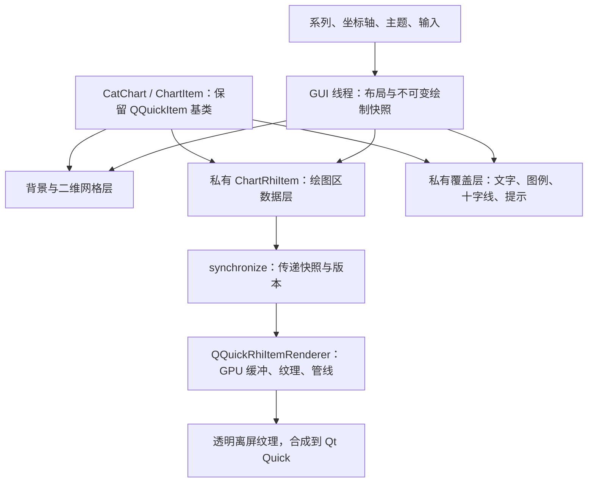

# CatChart RHI 架构与功能清单

[文档索引](README.md) · [当前图表 API](CHARTS.md) · [ABI 约定](ABI.md)

状态：M0–M4 的本文明确范围已实施；M4 E01–E10 的接口与限制见 [扩展图表](CHARTEXTENSIONS.md) 和 [统计图表](CHARTSTATISTICS.md)。2026-10-19 将 M5 范围收敛为图像导出并完成实现与本机验收，接口见 [图像导出](CHARTS.md#图像导出)。配置保存／恢复、迁移、同步及数据导出由应用实现，不再作为本库 M5 的待办。迁移前基线为 `70b5c84`。

M3 后续光照优化已加入默认 Blinn–Phong、线性颜色计算、半球补光与亮部压缩，保留 Phong 兼容模式；新增倒角立方体和网格精度。接口见 [三维图表](CHARTS3D.md)，本轮专项结果及全仓库两组既有失败见 [验证记录](VALIDATION.md#三维光照优化2026-10-17)。

2026-10-19 完成 Linux／XCB／AMD RADV／Qt 6.12 的 Vulkan 验证，并修复二维、三维默认裁剪状态初始化顺序。DPR 1／2 下二维、三维和 PNG 导出全部通过，同机 OpenGL 回归通过；具体数量与环境边界见 [Vulkan 验证记录](VALIDATION.md#vulkan-图表复测与裁剪修复2026-10-19)。三维阴影、三维 LOD 及其他平台验证仍为后续范围。

目标是在 `CatChart` 内部增加私有 `QQuickRhiItem` 数据层，按二维图表、三维图表、扩展图表、公共能力四部分推进。Qt Graphs 6.12 是功能与交互的对标版本；CatChart 保留自己的 API、主题和数据约定，不增加 Qt Graphs 运行时依赖。项目当前 Qt 6.8+ 的最低版本要求不因功能对标自动提高。

Qt Graphs 的主要分类是七类二维图表及三类三维图表；环形图复用饼图系列，三维样条由散点容器承载。因此，下面按可验收行为拆项，不以 QML 类的数量统计图表数量。[Qt Graphs 概览](https://doc.qt.io/qt-6/qtgraphs-index.html)、[三维图表概览](https://doc.qt.io/qt-6/qtgraphs-overview-3d.html)

十种基础二维类型已经迁移到 RHI，新增变体的已实现范围见进度表；各清单末列仍是完整验收目标，不表示全部已经实现。标为“增强”的项目是 CatChart 扩展范围，不能据此宣称 Qt Graphs 提供同名内置类型。

本轮进度：

| 范围 | 已实现 | 后续范围 |
| --- | --- | --- |
| C01、C03 | 私有数据层、独立覆盖层、不可变 GUI 绘制快照；渲染器不访问系列／轴 QObject | 三维快照见新增 ChartScene3D／ChartRhiItem3D |
| C02 | 保留 ChartItem 基类、Pimpl、既有枚举及 Sample 布局 | 三维独立 Point／网格、OHLC 和箱线统计适配器已新增 |
| M1 现有类型 | Line、Area、Bar、StackedBar、Scatter、Bubble、Pie、Doughnut、Radar、Heatmap 全部走 RHI | 三维见 M3；E01–E10 增强见 M4 |
| E01、E02、E03、E07、E08、E09 | 气泡独立大小／色带、格网数值纹理／稀疏实例和滚动、雷达样式／独立范围、等值线／填色、OHLC／成交量、箱线／离群点 | 端点、缺失、统计和预算约定见 [扩展图表](CHARTEXTENSIONS.md) |
| E04、E05 | CatChartStack 普通／百分比堆叠、严格 X 对齐、正负累计与原始记录映射；CatHistogram 自动／不等宽分箱、频数／频率／密度与端点规则 | API 与明确限制见 [统计图表](CHARTSTATISTICS.md)；不提供平滑堆叠或自动缺失 X 插值 |
| E06、E10 | CatChartFit 公共线性拟合与残差带；CatWaterfall 增减／小计／总计、重置及连接线 | 仅普通最小二乘，不含多项式拟合或概率区间；瀑布图首版纵向布局 |
| D02、D05 | 左／右／中心阶梯；自然三次、单调及 Catmull-Rom 样条；屏幕误差细分、曲线极值范围与原始记录拾取；有序 Line／Area 的分段层次 LOD 与控制点缓存 | 无序曲线的大数据 LOD 与流式更新控制点缓存优化；不将当前实现宣称为 Qt Graphs 逐像素相同拟合 |
| D03、D09 | 四种预设／纹理标记实例化、尺寸及形状拾取；虚线／偏移、端点／连接、尖角限制与反走样 | 无硬件实例化时使用等价展开回退 |
| D04 | 记录附加 breakBefore；七种曲线模式与面积断开，插值邻点隔离；覆盖／缩容保留标记；旧入口继续拒绝 NaN／Infinity；有序直线／阶梯／样条按连续段分别 LOD | NaN 适配器未提供（保持原入口的有限数值契约） |
| D06 | 零值／自定义／绘图区底部基线；独立边框／填充、不透明度、双色／多停止点渐变、纹理平铺／拉伸及错误回退 | 仅支持本地／qrc 图片，不提供网络下载 |
| D07 | 成对上下界与独立数组严格／线性对齐；七种曲线、断点、交叉、双边界极值及大数据 LOD；原始上下界拾取 | 无序输入保留完整几何路径 |
| D08 | 六种柱状布局、实例化、宽度／间距、独立边框、四种标签位置、模板、旋转及预算委托 | 标签不适合可用空间时省略 |
| D10、D11 | 局部／分离饼图、多层同心环、内外标签、预算标签委托、列避让与引线冲突筛选 | 拥挤／交叉路线按占比优先保留，其他标签省略 |
| C05 二维 | 反向、次刻度、四边／同侧多轴布局、显隐、系列独立关联、自动范围与堆叠隔离、映射／拾取／导航联动和销毁回退 | M3 已提供三维独立轴，刻度差异见 CHARTS3D.md |
| C06–C09 | double 局部映射、曲线／区间 LOD、预乘混合、实例化、纹理缓存和变化区间上传 | M4 已实现纹理热力图及变化区域上传；GPU LOD 属于后续增强 |
| C10 | 鼠标平移／框选、单轴选择、触摸平移／双指锚点缩放；取消和 Flickable 捕获协调；触摸导航开关、轻点原始记录拾取 | 真机触屏与其他操作系统验证 |
| C17 | software 回退、尺寸与 DPR 更新、跨窗口资源重建 | 设备丢失注入测试及其他平台验证 |
| C19 | CPU 准备耗时、RHI 回调、顶点上传次数／字节、分配次数、版本和错误可查询 | GPU 时间戳与完整基准矩阵 |
| C11–C13 | 显式选择／多选、独立高亮、屏幕 BVH 拾取索引、预算 QML 委托及生命周期、主题和 reducedMotion 淡入 | M3 已提供三维深度拾取；淡入不是几何形变动画 |
| C20 | Gallery、中英文、API、安装消费者与 GPU 回归覆盖 M2／M3／M4 新增能力 | 其他平台和后续阶段分别验收 |

具体测试环境、数量和安装消费者记录见 [验证说明](VALIDATION.md)。M2 以本文明确列出的二维行为验收，不表示提供 Qt Graphs 的同名 API 或全部三维／扩展功能。

采用以下内部结构；内部类型不属于公开 API：

绘制顺序为背景／二维网格、数据纹理、覆盖层。覆盖层必须是数据层上方的独立子项，不能继续把十字线画在会被子项覆盖的父项节点中。三维网格和需要深度遮挡的辅助几何进入三维渲染通道；其屏幕标签使用同一相机快照投影。

“独立渲染”指私有绘制通道与资源管理。`QQuickRhiItem` 使用所在窗口的 QRhi 实例和渲染线程，不为每张图创建图形设备或独立后端；它需要离屏纹理和后续合成。software 后端不能执行该通道，二维图表需保留现有回退。[QQuickRhiItem](https://doc.qt.io/qt-6/qquickrhiitem.html)

## 一、二维图表

每项均需验证单系列／多系列、空数据、动态更新、主题切换及拾取结果。几何效果、数据语义和交互分别验收。

| 编号 | 图表及变体 | 当前基础 | RHI 实现内容与验收条件 |
| --- | --- | --- | --- |
| D01 | 普通折线 | 已有 Line、线宽、可见范围峰谷采样 | 复用顶点／索引缓冲；保留首尾点和极值；一条记录不伪造线段；缩放和平移不改变原始数据；命中返回原始记录 |
| D02 | 左阶梯、右阶梯、中心阶梯 | 已实现并验证 | 明确每次跳变的位置；绘制、范围计算及命中使用相同语义；重复 X 和无序输入有确定结果 |
| D03 | 折线外观：实线、虚线、端点、连接、点标记 | 已有颜色、线宽、四种预设点标记、虚线图案／偏移、线端／连接与尖角限制；纹理标记及实例化见 D09 | 虚线按屏幕弧长计算；间隔、偏移及端点样式可设；锐角不产生无限尖刺；预设点标记和纹理标记走实例化路径；任意 QML 委托另按 C13 验收 |
| D04 | 缺失数据与断点折线 | 已实现显式 breakBefore；仍整批拒绝 NaN／Infinity | 增加显式分段／缺失标记契约；默认旧入口继续拒绝非法数据；如提供 Qt 风格 NaN 适配器，单独启用并验证；不得跨断点连线、插值或采样 |
| D05 | 样条曲线：自然三次、单调、Catmull-Rom | 三种算法已实现并验证 | 定义拟合算法和参数；按屏幕误差细分；验证端点、重复点、短序列和过冲；自动范围包含实际曲线范围；采样与命中不混淆控制点和原始点 |
| D06 | 基线面积图 | 三种基线、独立边框／填充色、双色／多停止点渐变和纹理填充已实现 | 保留默认零线语义；增加可配置基线／绘图区底部模式；支持边框、透明填充及渐变；正负区域、越界基线和重叠系列正确混合 |
| D07 | 区间面积图、上下界带 | 七种区间曲线及大数据 LOD 已实现；独立数组可严格／线性对齐 | 首版要求上下界 X 对齐；不对齐时明确拒绝，插值对齐作为独立选项；处理边界交叉、缺失区间、边框及上下界拾取 |
| D08 | 柱状图：纵向／横向 × 分组／堆叠／百分比堆叠 | 六种布局、实例化、宽度／间距、边框、标签／旋转／委托与占比拾取已实现 | 六种组合均可操作；实例化矩形；配置柱宽、间距、边框和标签；百分比模式明确零和分组、负值规则，零分母不产生 NaN；标签保留原值与占比 |
| D09 | 散点图：单／多系列、预设形状、纹理标记 | 四种预设／纹理标记与实例化已实现 | 圆、方、三角、菱形等共享几何或解析形状；按实例传位置／尺寸／颜色；透明边缘和 DPR 正确；显示大小与命中范围一致 |
| D10 | 饼图：完整、局部角度、分离扇区 | 完整／局部／分离 Pie、内外标签及引线已实现；拥挤标签省略 | 可设起止角、半径、扇区偏移、颜色和边框；标签避让；分离后命中跟随位置；保持现有非正值处理，其他规则显式配置 |
| D11 | 环形图：完整、局部角度、多层同心环 | 单环及多系列同心环已实现；每环独立占比与图例 | 可设内外半径及角度；多环支持独立系列和标签；内孔不可被命中；系列增删后不残留几何；明确多环系列映射 |

Qt 对标依据：[折线及阶梯／虚线](https://doc.qt.io/qt-6/qml-qtgraphs-lineseries.html)、[样条](https://doc.qt.io/qt-6/qml-qtgraphs-splineseries.html)、[面积上下界](https://doc.qt.io/qt-6/qml-qtgraphs-areaseries.html)、[柱状分组方式](https://doc.qt.io/qt-6/qml-qtgraphs-barseries.html)、[横向柱状与视图](https://doc.qt.io/qt-6/qml-qtgraphs-graphsview.html)、[散点](https://doc.qt.io/qt-6/qml-qtgraphs-scatterseries.html)、[饼图／环形](https://doc.qt.io/qt-6/qml-qtgraphs-pieseries.html)、[扇区外观](https://doc.qt.io/qt-6/qml-qtgraphs-pieslice.html)。表中具体边界处理和 GPU 实现方式是 CatChart 的设计目标。

必须保留的现有差异：Area 默认填充至零线，不能在迁移时直接改为 Qt Graphs 的绘图区底部；现有饼图忽略非正值，不能自动改成其他库的数值转换规则。对标视觉能力不等于悄悄改变已有数据语义。

## 二、三维图表

本部分已新增独立三维数据契约、相机与私有深度渲染管线，接口及明确限制见 [三维图表](CHARTS3D.md)。阴影单独推进，当前没有实时阴影或光晕。

| 编号 | 图表及变体 | 数据与绘制方案 | 验收条件 |
| --- | --- | --- | --- |
| T01 | 三维柱状：单系列柱阵、多系列分组柱阵 | 行／列分类与高度数据；共享立方体或其他柱体网格，实例化绘制 | 基准面、正负高度、行列顺序、间距、系列布局、选中高亮和标签一致；切片不改变源数据 |
| T02 | 三维散点：普通散点、不同形状、自定义网格 | XYZ 点与可选尺寸／颜色／旋转；共享网格和实例缓冲 | 深度遮挡正确；大坐标稳定；动态增删和缩放正常；拾取最近可见对象，不穿透选择被遮挡点 |
| T03 | 三维曲线：开放轨迹、闭合样条轨迹 | XYZ 序列；曲线细分及带宽几何；与散点共用三维场景 | 张力、闭合、细分精度可设；近裁剪面和退化线段不产生异常；可同时显示数据节点 |
| T04 | 三维曲面：填充、线框、填充加线框、高度图 | 规则网格索引、法线、数值色带或纹理；高度图通过数据适配器输入 | 三种绘制模式均可切换；线框不明显闪烁；缺失单元不错误连面；点／行／列选择及切片有清晰语义 |
| T05 | 三维散点／曲面的极坐标变体 | 角度、半径、高度转换后进入同一三维数据层 | 角度单位明确；处理角度接缝和零半径；拾取可还原数据坐标；不作为三维柱状图的模式 |

三维柱状不因支持多系列就算实现三维堆叠；三维堆叠若有需求需另列数据与布局规则。任意三角网格曲面也不能用“规则高度网格已实现”代替验收。

Qt 对标依据：[Bars3D](https://doc.qt.io/qt-6/qml-qtgraphs-bars3d.html)、[Scatter3DSeries](https://doc.qt.io/qt-6/qml-qtgraphs-scatter3dseries.html)、[Spline3DSeries](https://doc.qt.io/qt-6/qml-qtgraphs-spline3dseries.html)、[Surface3DSeries](https://doc.qt.io/qt-6/qml-qtgraphs-surface3dseries.html)、[相机与极坐标](https://doc.qt.io/qt-6/qml-qtgraphs-graphsitem3d.html)。

## 三、扩展图表

本部分包括需要迁移的 CatChart 现有类型，以及在基础图元上组合或新增的能力。Qt 对标基础以外的项目标为“增强”，不计入 Qt Graphs 的七类二维／三类三维类型。

| 编号 | 类型及变体 | 当前基础／范围 | RHI 实现内容与验收条件 |
| --- | --- | --- | --- |
| E01 | 气泡图：尺寸、颜色及组合映射 | 已实现 CatChartBubble 独立半径／面积与颜色映射，保留旧 Bubble 约定 | 实例化点图元；保留 value 为逻辑像素半径的现有约定；面积编码须作为独立模式；颜色映射有图例及固定／自动范围 |
| E02 | 热力图：规则格网、非连续单元、滚动热力图 | 已实现 CatChartGrid 数值纹理／稀疏实例、null 缺口、单格更新与滚动行 | 密集规则格网用数值纹理＋色带，稀疏单元用实例化矩形；局部纹理更新；缺失值、等值范围、超范围值定义明确；两条路径语义一致 |
| E03 | 雷达图：线型、填充、多系列比较 | 已实现闭合描边／填充样式、标记与 radarRanges 独立维度归一化 | 共享二维三角形通道；维度标签、闭合边、范围归一化和拾取一致；迁移保持现有最多 32 维约定，扩容另行验收 |
| E04 | 堆叠面积：普通、百分比 | 已实现 CatChartStack，首版严格 X 对齐、线性边界 | X 对齐、正负累计与百分比转换后生成上下界；原始数据不被累计值覆盖；零分母与缺失分组有明确规则 |
| E05 | 直方图：等宽、自定义分箱、频数／频率／密度 | 已实现 CatHistogram，保留原始输入与分箱元数据 | 分箱与统计独立于矩形渲染；明确区间端点归属；验证计数总和、频率总和及密度积分 |
| E06 | 组合图：柱＋线、散点＋拟合线、曲线＋区间带 | 已实现同坐标／多轴系列组合；新增 CatChartFit 公共普通最小二乘与残差带 | 复用系列绘制顺序与混合；保留原始命中；多轴依赖 C05；统计拟合不能因 Gallery 示例存在就视为公共库能力 |
| E07 | 等高线、填色等值区域 | 已实现 CatChartContour，四三角形分片场、缺失单元、色带和标签 | 从规则格网提取等值几何；处理歧义单元、边界和缺失区域；等值标签／色带与热力图一致 |
| E08 | K 线／OHLC、成交量组合 | 已实现 CatChartOhlc，原始时间／压缩交易间隔和独立成交量系列 | 新的数据契约表达开高低收；共享矩形／线段通道；校验价格范围、交易时间间隙和涨跌样式；拾取返回完整 OHLC |
| E09 | 箱线图、离群点 | 已实现 CatChartBoxPlot，Type 7 分位数、IQR 须长、原始／摘要来源 | 明确分位数算法、须长和离群点规则；统计与绘制分离；允许输入原始观测或已计算统计量，并标记来源 |
| E10 | 瀑布图：增减量、分组小计、总计 | 已实现 CatWaterfall，纵向增减、小计重置与连接线 | 先算累计起止位置，再实例化矩形并绘制连接线；明确负值、小计重置和总计语义 |

多环、组合图、拟合线与分箱统计不需要各自创建一个 RHI 子项。默认每个 CatChart 只有一个数据 RHI 子项；同一通道内共享资源，按需要切换管线。

## 四、公共能力

下表同时包括 Qt 对标能力、现有兼容要求和自研渲染器必需的工程工作。对数轴、多轴、状态持久化、采样预算及 GPU 统计作为 CatChart 自身能力验收，不推断 Qt Graphs 对所有这些项目都有等价接口。

| 编号 | 能力 | 当前基础 | 实现与验收清单 |
| --- | --- | --- | --- |
| C01 | 私有 RHI 数据层与合成 | 已实现私有 RHI 与独立覆盖层 | 保留 ChartItem 基类和 Pimpl；按绘图区创建私有子项；预乘透明输出、alphaBlending、正确裁剪；数据不得遮住覆盖层或重复绘制 |
| C02 | 数据契约与 ABI | 已有 XY/value/label、系列和坐标轴 | 保留 Sample 布局、旧枚举值和信号；XYZ、上下界、OHLC、网格等采用新增契约，不把 value 改成 Z；所有公开扩展经 ABI 与安装消费者验证 |
| C03 | 线程、快照、更新版本 | 已有对象线程批次 API | GUI 线程接收批次并发布不可变快照；synchronize 只复制快照句柄和配置；渲染线程不遍历 QObject 系列、不修改源数据；数据、样式、布局、相机使用独立版本 |
| C04 | 批量与流式数据 | 已有追加、替换、清空、容量覆盖 | 增加精确的变化区间；合并同一帧更新；重复追加、环形覆盖、缩容及清空可追踪；模型适配器保留稳定记录身份 |
| C05 | 坐标轴与布局 | 已有线性、对数、时间、分类及自动／手动范围；反向与次刻度已实现 | 保留格式化、精度及已有 map API；补轴侧选择、多轴与系列关联；三维有独立 Z／行列轴；径向坐标不套用笛卡尔映射 |
| C06 | 数值精度 | 当前准备过程使用 CPU 数据计算 | 时间戳和大坐标先以 double 减去局部原点再转 GPU float；检查百万级偏移下小范围缩放、对数轴和近重合数据；标签与几何不漂移 |
| C07 | GPU 资源与上传 | 新增 | 缓冲按容量增长并复用；仅上传脏区；静态网格只在重建时上传；统一管理 SRB、纹理、管线；同一帧无数据变化时不上传系列缓冲 |
| C08 | 大数据与 LOD | 已有折线／面积预算；Gallery 有独立概览 | 保留源数据；随可见范围重算 LOD；明确每种图表的采样／聚合语义；统计原始量、可见量、实际绘制量；不能把聚合概览当作全部图元直接绘制 |
| C09 | 渲染质量与顺序 | 已有二维覆盖率边缘 | 曲线／圆形抗锯齿、透明叠加顺序、DPR、裁剪边界、窗口 opacity 和 layer 使用正确；MSAA 按后端能力选择；不得为了合批改变透明系列的顺序 |
| C10 | 二维输入 | 已实现鼠标、键盘、双轴／单轴框选、触摸平移／双指缩放及 Flickable 协调 | 保留现有缩放／平移／重置；增加框选缩放、触摸平移与双指缩放；处理取消、失焦、禁用、滚动容器竞争；私有数据子项不抢输入 |
| C11 | 拾取、选择、提示 | 已有原始命中、屏幕索引、显式选择／多选、悬停、点击和十字线 | 空间索引与可见范围筛选；显式选择状态、多选与选中样式；三维按可见深度确定命中；如使用 GPU ID 拾取，异步读取并核对帧版本，避免每帧同步读回 |
| C12 | 主题、文本与动画 | 已有主题、缓存文字、标签避让和可选淡入；遵循 reducedMotion | 保留动态主题和语言；补标签避让及选择配色；覆盖层独立更新，悬停不触发全量数据上传；过渡动画遵循 reducedMotion，不能停止应用主动数据更新 |
| C13 | 自定义标记与柱体 | 已提供有预算的 QML pointDelegate／barDelegate／labelDelegate | 预设形状、图像纹理和共享网格为 GPU 路径；任意 QML pointDelegate/barDelegate/labelDelegate 使用独立 UI 适配层与数量预算，保留组件生命周期和交互；不能以纹理标记声称完全兼容任意 QML 委托 |
| C14 | 三维相机与空间交互 | 新增 | 旋转／平移／缩放、目标点、预设视角、透视／正交、近远裁剪面、视图复位；相机、投影标签、拾取与切片使用同一快照 |
| C15 | 三维材质、深度与辅助场景 | 新增 | 深度测试、法线、环境／漫反射／镜面反射参数、颜色映射、选中高亮；三维坐标框和网格参与正确遮挡；阴影单独实现和验收 |
| C16 | 设置保存、恢复与同步 | 应用负责，不纳入 M5 | 应用根据自己的数据模型和稳定标识保存配置、处理版本迁移及同步反馈循环 |
| C17 | 生命周期、后端与回退 | 已有二维 software 回退 | 不在 software 下创建有效 RHI 通道；二维保留可用回退；三维不支持时明确报告；处理窗口重建、跨窗口迁移、隐藏／销毁、DPR／尺寸／MSAA 变化；不跨 QRhi 复用资源 |
| C18 | 图像导出 | M5 当前视图 PNG 导出已完成 | 包含标题、坐标轴、图例、二维／三维数据和覆盖层；异步抓取、指定像素尺寸、透明度与失败反馈。原始数据导出及额外可访问数据表由应用实现；保留既有键盘和可访问性行为 |
| C19 | 性能指标与平台验证 | 已有 preparationNanoseconds，尚无图表 GPU 基准 | 分开记录 CPU 准备、提交、GPU 时间、呈现 FPS、上传字节及显存估算；不可用 GPU 时间时报告不可用；记录后端、设备、DPR、绘制量和更新频率 |
| C20 | Gallery、文档与安装交付 | 已覆盖 M2 新增能力 | 每个变体有可操作示例、状态反馈、中英文文案、公开文档、qmltypes、安装头及消费者；Gallery 辅助类型不导出为库 API |

Qt 对标依据：[二维容器、平移与框选缩放](https://doc.qt.io/qt-6/qml-qtgraphs-graphsview.html)、[三维相机与场景](https://doc.qt.io/qt-6/qml-qtgraphs-graphsitem3d.html)、[自定义点](https://doc.qt.io/qt-6/qml-qtgraphs-scatterseries.html)、[自定义柱体](https://doc.qt.io/qt-6/qml-qtgraphs-barseries.html)。

### 私有实现分工

二维分层、实例、纹理、委托、选择与拾取索引已实现；M3 新增三维场景、共享网格／索引和实例。私有类型不导出为应用 API：

| 文件／模块 | 职责 |
| --- | --- |
| `qcatchartitem.cpp` | 继续持有公开交互、主题、坐标轴、布局和系列；从 Impl 管理各私有子层 |
| `qcatchartrhiitem_p.h` / `qcatchartrhiitem.cpp` | 私有 QQuickRhiItem 及 renderer；同步快照、资源生命周期、绘制提交；不注册为公共 QML 类型，不安装私有头 |
| `qcatchartrhiitem_p.h` 中的私有快照 | 二维顶点、实例、纹理、绘制命令与版本；三维使用独立 qcatchart3d_p.h 快照 |
| 图表几何／布局辅助模块 | 共享采样、细分、堆叠、分箱与命中数据；与 GUI 对象解耦，供 RHI 和二维回退复用 |
| 私有覆盖层 | 缓存文字、图例、十字线、提示、选择框；与数据层使用相同布局快照 |
| `shaders/chart*.vert/.frag` | 三角形、实例标记、数值纹理、三维网格等管线；通过 qt_add_shaders 打包 .qsb |

首个版本已将现有二维三角形批次上传到 RHI，并复用缓冲、比较变化区间后上传。静止重绘和仅悬停时不上传系列顶点，未改变的背景节点继续保留。散点／柱体实例化已验证变化区间上传；M4 已加入规则热力图数值纹理与变化矩形上传；更细粒度 CPU 数据脏区仍属后续增强。本轮不宣称 CPU 几何准备已整体增量化。

新增公开类型时遵守安装头、转发头、QML 类型注册及 [ABI 规则](ABI.md)。QRhi 留在私有实现中，Qt 小版本升级时重新构建和验证；项目已有私有 GuiPrivate 依赖，但这不构成 QRhi 跨版本二进制兼容承诺。

### M2 收尾执行清单

以下项目已按依赖顺序完成，复选框对应实现、Gallery、文档及验证记录。最终验收见 [VALIDATION.md](VALIDATION.md) 的“M2 最终验收”。

- [x] C05：轴侧选择、多轴布局、系列关联、范围／映射／拾取与交互联动、生命周期。
- [x] D03：线端和连接样式，虚线衔接、锐角限制及反走样。
- [x] D06：多停止点渐变和纹理填充。
- [x] D07：独立上下界数组的明确对齐／插值契约及大规模区间 LOD。
- [x] D08／D09／C13：柱形和预设标记实例化、纹理标记、柱形标签旋转；有预算的 QML 标记／柱体／标签委托与生命周期。
- [x] C11：显式选择、多选、选中样式及拾取索引。
- [x] D10／D11／C12：标签避让与引线交叉处理、标签委托、主题及 reducedMotion 过渡。
- [x] C20：全部新增能力的 Gallery、中英文、文档、测试、真实 GPU、安装和历史消费者验收。

### M3 执行清单

本轮验收及未覆盖平台见 [VALIDATION.md](VALIDATION.md) 的“M3 验收”。

- [x] C02：独立 ChartSeries3D.Point、行优先网格、局部 double 映射；旧 Sample／枚举不变。
- [x] C14／C15：轨道相机、目标／投影／裁剪、深度、Blinn–Phong／Phong 三分量、补光／曝光、鼠标与触摸导航；相机／材质修改零几何重建。
- [x] T01／T02：分组正负柱阵、共享散点网格、逐点尺寸／颜色／旋转、自定义三角形网格。
- [x] T03：开放／闭合轨迹、张力与细分预算、退化与缺口、可选节点。
- [x] T04／T05：共享顶点索引曲面、填充／线框／纹理／高度图；极坐标散点和曲面、接缝与零半径。
- [x] C11／T01–T05：对象 BVH 与最近三角形拾取、原始记录、点／行／列高亮、行列切片及投影标签。
- [x] C20：Gallery 中英文、明暗与窄屏、CPU／GPU 回归、安装与历史消费者验收。

阴影、三维 LOD、任意模型文件解析、透明排序、曲面任意三角网格及平台扩展不在本轮完成声明中；数据契约、预算和轴标签差异见 CHARTS3D.md。

### 实现顺序与完成标准

阶段顺序不删除清单中的后续范围。公共能力跨阶段推进，每阶段都有独立验收结果。

| 阶段 | 范围 | 完成标准 |
| --- | --- | --- |
| M0 | C01–C03、C17：分层、快照、ABI、回退骨架 | 一个 CatChart 的私有数据层正常合成；二维旧路径可比较；覆盖顺序和输入不变；纯 C++ 使用不要求 QML 引擎 |
| M1 | 迁移现有十个二维类型，含 E01–E03 的基础能力；C06–C09、C19 | 现有图表外观和交互回归通过；真实 GPU 渲染通过；资源复用和静止时零系列上传有证据；不能只以 software 测试通过作为完成依据 |
| M2 | D02–D11 的新增变体；C05、C10–C13 | 七类二维图表及明确列出的变体均有示例和测试；任意委托等差异逐项记录，未实现项不能标为对标完成 |
| M3 | T01–T05；C02 的三维数据扩展、C14–C15 | 三维相机、材质、遮挡、拾取与切片完成；规则曲面和轨迹行为可验证；后端限制可观察 |
| M4 | E01–E10 的增强部分 | 每种新增数据语义、统计规则及异常输入有测试；GPU 绘制与统计计算可独立验证 |
| M5 | C18 的图像导出 | PNG 完整视图、尺寸／DPR、透明度、失败与生命周期、Gallery、安装消费者形成记录；仅声明实际验证的平台。C16、数据导出及额外可访问数据表由应用负责，其余性能／平台增强独立跟踪 |

最低验收集合：

- 现有 `tests/auto/charts`、QML 图表测试和 Gallery 数据测试继续通过；新增几何算法以边界和语义测试为主。
- 新增真实 GPU 图表测试，验证像素覆盖、混合、裁剪、坐标映射、三维遮挡及资源重建。现有 charts CTest 使用 software，不能证明 RHI 正常。
- 真实检查明暗主题、桌面与窄屏密度、DPR 1／2、窗口缩放、透明父项、layer、ScrollView 和多图表并存。
- 先在开发环境的 D3D11 验证；D3D12、Vulkan、OpenGL、Metal 分别记录实际测试平台。未测试后端保持未验证，不把 shader 成功编译当作运行验证。
- 基准分别覆盖静态与实时追加、全量与 LOD、单图与多图。使用 1 万／10 万／100 万原始记录时同时报告实际绘制量；先保存旧路径基线，再比较 CPU、GPU、上传量、内存和交互延迟，不预先承诺统一 FPS。
- 公开扩展通过安装消费者和已有二进制替换检查；每阶段完成构建、相关测试、QML lint、Gallery 实际交互及文档更新。

清单只有在对应实现、示例、测试和验证记录齐备时才标记完成。本文建立开发范围，不替代 [当前图表 API 文档](CHARTS.md)。
